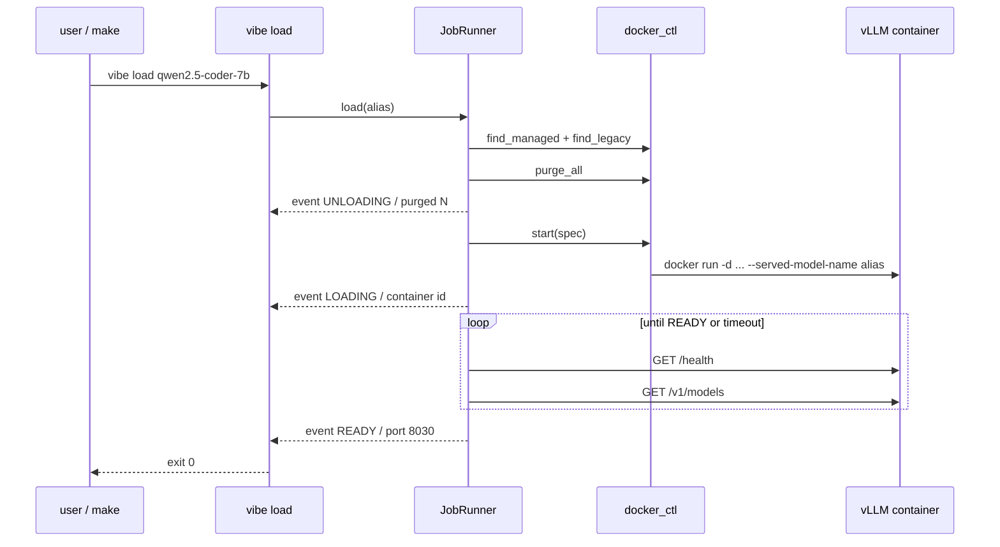

# 00 — Foundation

> Phase 0 · Depends on: nothing · Status: Implemented

## Summary

Replace the three bash scripts and Makefile glue with a small Python package (`vibe`) driven by a
`models.yaml` registry. This phase produces no servers — only a CLI — but every later phase builds on
its modules: `config.py`, `registry.py`, `docker_ctl.py`, `gpu.py`, `jobs.py`. At the end,
`make qwen` still works but calls `uv run vibe load qwen2.5-coder-7b` underneath.

## Goals / Non-goals

**Goals**
- Single source of truth for model parameters (`models.yaml`).
- Detached, labelled, pinned-image containers bound to loopback.
- Reliable readiness detection and typed failure modes.
- A job abstraction (`jobs.py`) that the gRPC server will stream in Phase 1 without changes.
- Remove `scripts/start_*.sh`; fix stale README ports.

**Non-goals**
- Any server (gRPC, HTTP, UI) — Phase 1+.
- Model downloads as a first-class feature — Phase 4 (containers still pull lazily via HF cache).
- Multi-model residency.

## Requirements

### Functional

| ID | Requirement |
| --- | --- |
| FR-00.1 | `models.yaml` defines a list of models with fields: `alias, display_name, hf_repo, quantization, max_model_len, gpu_memory_utilization, container_name, host_port, extra_args[], use_case, tags[]`. |
| FR-00.2 | Registry validation rejects: duplicate `alias`, `host_port`, or `container_name`; alias not matching `^[a-z0-9][a-z0-9.-]*$`; `gpu_memory_utilization` outside `(0, 1]`; `max_model_len < 1`. |
| FR-00.3 | `vibe list` prints all aliases with display name, repo, port, and (if a container is running) state. |
| FR-00.4 | `vibe validate` loads `.env` + `models.yaml` and exits 0 on success, 2 on validation error, printing every error (not just the first). |
| FR-00.5 | `vibe load <alias> [--force] [--keep-failed] [--timeout S]` purges all managed (`vibe.managed=true`) and legacy (`vllm-*`) containers, starts the target detached, waits for readiness, and streams progress lines to stdout. `--force` reloads even if the alias is already `READY`. `--keep-failed` skips removal of a failed container so its logs can be inspected. |
| FR-00.6 | `vibe unload` stops and removes any managed/legacy containers; idempotent. |
| FR-00.7 | `vibe status [--json]` shows the active alias and state, container uptime, host port, GPU used/total memory, and compute processes. |
| FR-00.8 | `vibe logs [--tail N] [--follow]` streams the active container's logs. |
| FR-00.9 | Container start uses `vllm/vllm-openai:${VLLM_IMAGE_TAG}`, `--gpus all --ipc=host`, bind `127.0.0.1:<host_port>:8000`, mounts `HF_HOME` at `/root/.cache/huggingface`, passes `HF_TOKEN`, sets labels `vibe.managed=true`, `vibe.alias=<alias>`, and passes `--served-model-name <alias>` plus `extra_args`. |
| FR-00.10 | Readiness = `GET /health` returns 200, then `GET /v1/models` lists the alias. Timeout defaults to `VIBE_LOAD_TIMEOUT` (600 s). |
| FR-00.11 | On failure, the last 50 container log lines are captured into the error and printed. |
| FR-00.12 | Makefile targets `deepseek|qwen|llama|stop|status|kill-ghosts` remain and delegate to the CLI. New: `make validate`, `make list`, `make logs`. |
| FR-00.13 | Exit codes: `0` ok, `1` runtime error (Docker/GPU/timeout), `2` config/validation error, `3` invalid alias. |

### Non-functional

| ID | Requirement |
| --- | --- |
| NFR-00.1 | Control plane dependencies: `pydantic`, `pydantic-settings`, `pyyaml`, `docker`, `httpx`, `pynvml`, `typer` (or `argparse`). **No torch.** |
| NFR-00.2 | `uv sync` on a clean checkout completes without CUDA/torch downloads. |
| NFR-00.3 | All Docker and NVML access is in `docker_ctl.py` and `gpu.py` respectively; everything else is pure Python and unit-testable. |
| NFR-00.4 | `VLLM_IMAGE_TAG=latest` (or unset) fails validation with a message naming a suggested pinned tag. |
| NFR-00.5 | Readiness polling interval ≤ 2 s so `vibe load` reports READY within 2 s of the server being up. |

## Architecture

### Modules

| Module | Responsibility |
| --- | --- |
| `config.py` | `Settings` (pydantic-settings) reading `.env`: `HF_TOKEN, VIBE_DATA_DIR, VIBE_BIND, VIBE_SWAP_ON_REQUEST, VIBE_SWAP_TIMEOUT, VIBE_LOAD_TIMEOUT, VLLM_IMAGE_TAG`. Derives `hf_home`. Validates image tag. |
| `registry.py` | `ModelSpec` (pydantic model, one entry) and `Registry` (load from YAML, validators for uniqueness/regex, `get(alias)`, `by_port(port)`). |
| `docker_ctl.py` | `find_managed()`, `find_legacy()`, `purge_all()`, `start(spec, settings) -> Container`, `stop(container)`, `logs(container, tail, follow)`, `wait_ready(spec, timeout)`. Errors: `ImagePullError`, `ContainerExited(last_logs)`, `ReadinessTimeout(last_logs)`. |
| `gpu.py` | `GpuStats(used_mib, total_mib, utilization_pct, processes[])` via `pynvml`; falls back to parsing `nvidia-smi --query-gpu ... --format=csv` if NVML unavailable inside the sandbox. |
| `jobs.py` | `Job(id, kind, alias, state, started_at)`, `JobEvent(ts, level, message, state?, progress?)`, `JobRunner.load(alias, force) -> AsyncIterator[JobEvent]`, `JobRunner.unload() -> AsyncIterator[JobEvent]`. Holds the single in-flight job (a second concurrent load is rejected with `JobInProgress`). |
| `cli.py` | Typer app: `list, validate, load, unload, status, logs`. Consumes `JobRunner` async generators and prints them. |

### Load sequence



### `models.yaml` (initial content)

```yaml
models:
  - alias: qwen2.5-coder-7b
    display_name: Qwen2.5 Coder 7B Instruct (AWQ)
    hf_repo: Qwen/Qwen2.5-Coder-7B-Instruct-AWQ
    quantization: awq
    max_model_len: 32768
    gpu_memory_utilization: 0.70
    container_name: vibe-qwen2.5-coder-7b
    host_port: 8030
    extra_args: ["--enable-auto-tool-choice", "--tool-call-parser", "hermes"]
    use_case: Code generation, repository parsing, Zed agent default
    tags: [code, tools]

  - alias: llama-3.1-8b
    display_name: Llama 3.1 8B Instruct (AWQ INT4)
    hf_repo: hugging-quants/Meta-Llama-3.1-8B-Instruct-AWQ-INT4
    quantization: awq
    max_model_len: 16384
    gpu_memory_utilization: 0.75
    container_name: vibe-llama-3.1-8b
    host_port: 8020
    extra_args: ["--enable-auto-tool-choice", "--tool-call-parser", "llama3_json"]
    use_case: Writing, brainstorming, general chat
    tags: [general, tools, gated]

  - alias: deepseek-r1-14b
    display_name: DeepSeek R1 Distill Qwen 14B (AWQ)
    hf_repo: casperhansen/DeepSeek-R1-Distill-Qwen-14B-AWQ
    quantization: awq
    max_model_len: 7984
    gpu_memory_utilization: 0.85
    container_name: vibe-deepseek-r1-14b
    host_port: 8010
    extra_args: []
    use_case: Deep reasoning, logic problems
    tags: [reasoning]
```

### Makefile after Phase 0

```make
-include .env
export
UV ?= uv run vibe

qwen:      ; $(UV) load qwen2.5-coder-7b
llama:     ; $(UV) load llama-3.1-8b
deepseek:  ; $(UV) load deepseek-r1-14b
stop:      ; $(UV) unload
status:    ; $(UV) status
logs:      ; $(UV) logs --follow
validate:  ; $(UV) validate
list:      ; $(UV) list
kill-ghosts: stop
```

## Task breakdown

- [ ] **M0.1 — Project skeleton (S)**: `pyproject.toml` (uv, Python 3.12, `src/` layout, `vibe` console script), `.env.example` with all ADR-10 keys, `.gitignore` additions (`.env`, `laboratory/models/`).
- [ ] **M0.2 — Config + registry (M)**: `config.py`, `registry.py`, `models.yaml`; unit tests for every validator in FR-00.2 and NFR-00.4.
- [ ] **M0.3 — Docker + GPU adapters (M)**: `docker_ctl.py`, `gpu.py`; integration test guarded by `VIBE_INTEGRATION=1` that starts and tears down the smallest model.
- [ ] **M0.4 — Job runner (M)**: `jobs.py` with load/unload async generators, single in-flight job guard, error → `JobEvent(level=error)` mapping, last-50-lines capture.
- [ ] **M0.5 — CLI (M)**: `cli.py` commands per FR-00.3–FR-00.8, exit codes per FR-00.13, `--json` for `status`.
- [ ] **M0.6 — Cutover (S)**: Makefile rewrite, delete `scripts/start_*.sh`, update repo `README.md` (ports, `make` table, remove docker-run snippet in favour of `models.yaml`), point `scripts/test_chat.py` at a fixed port + alias (temporary until Phase 2).

## Acceptance criteria

- `uv sync && uv run vibe validate` exits 0 on a fresh clone with a populated `.env`.
- `make qwen` returns within `VIBE_LOAD_TIMEOUT`, prints `READY`, and `curl localhost:8030/v1/models` lists `qwen2.5-coder-7b`.
- `make deepseek` after `make qwen` leaves exactly one container with `vibe.managed=true` and `nvidia-smi` shows one compute process.
- Starting a legacy `vllm-qwen` container manually, then `make llama`, results in the legacy container being removed.
- `VLLM_IMAGE_TAG=latest make validate` exits 2 with a clear message.
- `uv run vibe load nope` exits 3.
- `scripts/start_*.sh` no longer exist; `uv run pytest` passes.

## Risks & open questions

- **NVML inside sandboxed shells** may be unavailable → `nvidia-smi` fallback is mandatory, not optional.
- **Pinned vLLM tag vs. AWQ kernels**: choose a tag known to support these AWQ checkpoints on Ada (sm_89); record it in `.env.example` with the date tested.
- **`--ipc=host`** is retained from v0; revisit with `--shm-size` if a hardened profile is wanted later.
- **Gated Llama repo**: readiness failure due to missing/invalid `HF_TOKEN` must surface as a distinct message (grep container logs for `401`/`gated`).
- Open: should `vibe load` warn when `gpu_memory_utilization × 16 GB` exceeds free VRAM minus desktop overhead (~830 MiB)? Proposed: yes, warn only.
