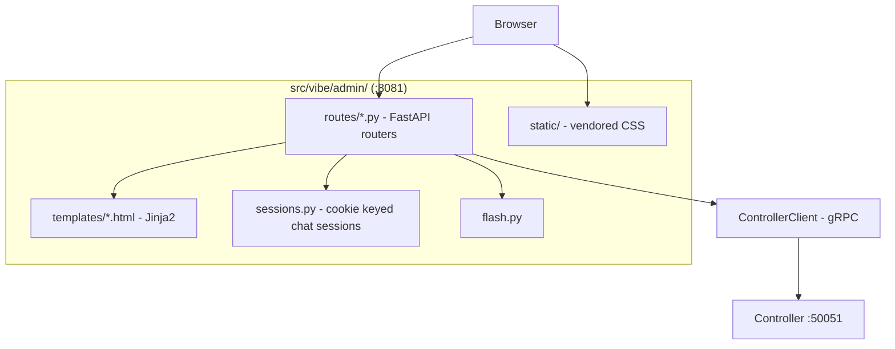
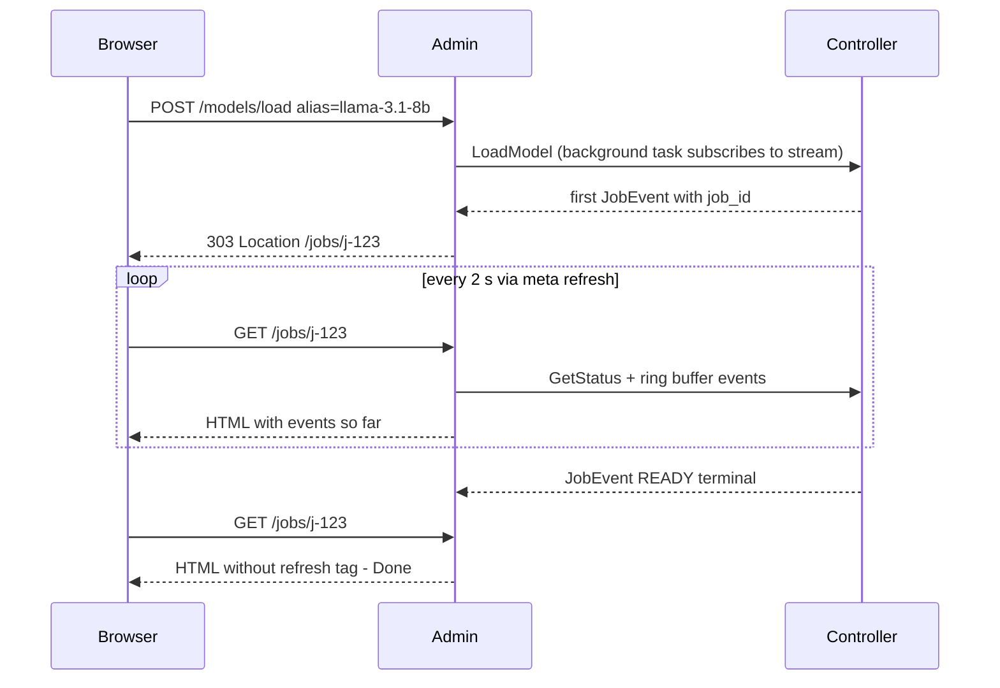
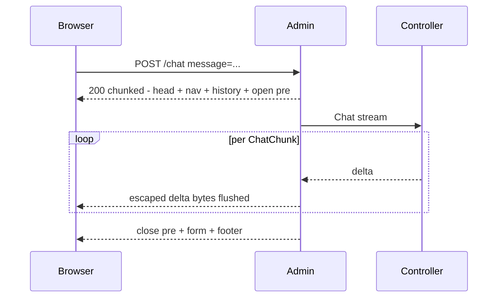

# 01 — Admin UI

> Phase 3 · Depends on: 02-grpc-server, 03-openai-gateway · Status: Implemented

## Summary

A browser UI on `http://localhost:8081` to see what's loaded, start/stop/hot-swap models, watch load
progress and logs, and chat with the active model. Built with FastAPI + Jinja2 and **zero JavaScript**:
live views use `<meta http-equiv="refresh">`, actions are plain HTML forms with POST-redirect-GET, and
chat streams via chunked HTML. All state comes from the controller over gRPC.

## Goals / Non-goals

**Goals**
- Replace "which `make` target do I run?" with a one-page dashboard and a Load button.
- Show job progress and container logs without a terminal.
- Quick chat sanity check against the active model.
- Stay dependency-light: no CDN, no JS bundle, no build step.

**Non-goals**
- Multi-user, auth, or remote access (loopback only).
- A full chat client (history export, markdown rendering beyond `<pre>`, tool-call UI).
- Editing `models.yaml` in the browser (Phase 4 adds a guided register flow; free-form editing stays in the editor).

## Requirements

### Functional

| ID | Requirement |
| --- | --- |
| FR-01.1 | `GET /` dashboard: active alias + state badge, container uptime and port, GPU used/total MiB + utilization bar (CSS width), compute processes, controller/gateway health, current job (if any) with link to `/jobs/<id>`. Auto-refresh every 5 s. |
| FR-01.2 | `GET /models`: table of all registry models (display name, alias, repo, quant, max len, port, state, cached-locally). A `<select>` + **Load** button (POST `/models/load`), a **Force reload** checkbox, and an **Unload** button (POST `/models/unload`). |
| FR-01.3 | `POST /models/load` calls `LoadModel` in the background (job continues independent of the HTTP request), then `303` redirects to `/jobs/<job_id>`. If a job is already running, redirect to that job with a flash message. |
| FR-01.4 | `GET /jobs/<id>`: job kind, alias, elapsed, latest state, the event log so far (from the controller's ring buffer / job fan-out), auto-refresh every 2 s while running; refresh stops (no meta tag) once terminal; terminal page shows success or the captured error + last 50 container log lines and links back to `/models` and `/`. |
| FR-01.5 | `GET /chat`: a `<textarea>` + Send form; conversation rendered as alternating blocks. `POST /chat` appends the user turn to a server-side session (cookie `vibe_session`, in-memory dict, TTL 24 h), then **streams** the response page: header + history flushed immediately, assistant text appended chunk-by-chunk inside a `<pre>` as `ChatChunk`s arrive, then a footer with the form. `POST /chat/reset` clears the session. |
| FR-01.6 | `/chat` shows "no model loaded" with a link to `/models` when state ≠ `READY`. Optional `temperature` and `max_tokens` fields (defaults 0.7 / 1024). |
| FR-01.7 | `GET /logs?tail=200`: last N lines of the active container (or last-job ring buffer) in a `<pre>`, auto-refresh 5 s, `tail` selector 100/200/500/1000. `GET /logs/stream`: chunked `text/plain` follow-mode for `curl`/browser tab. |
| FR-01.8 | `GET /developer`: placeholder in Phase 3 (links to Phase 4 spec); becomes the downloads/registry page in Phase 4. |
| FR-01.9 | `GET /health` → JSON `{"admin":"ok","controller":"ok|down"}`. |
| FR-01.10 | Every page has a nav bar (`Dashboard · Models · Chat · Logs · Developer`) and a footer with the gateway URL (`http://localhost:8080/v1`) and active alias for copy-paste into Zed. |
| FR-01.11 | Flash messages via a short-lived cookie, rendered once and cleared. |

### Non-functional

| ID | Requirement |
| --- | --- |
| NFR-01.1 | **Zero JavaScript**: no `<script>` tags, no inline handlers. CSP header `default-src 'self'; script-src 'none'; style-src 'self'`. |
| NFR-01.2 | CSS vendored at `src/vibe/admin/static/pico.min.css` (Pico.css classless) or a ~100-line handwritten `vibe.css`; no external requests. |
| NFR-01.3 | Bind `${VIBE_BIND:-127.0.0.1}:8081`. |
| NFR-01.4 | All controller access via `ControllerClient`; no `docker`/`pynvml` imports (XR-5). |
| NFR-01.5 | Pages render in < 100 ms excluding gRPC round-trips; gRPC calls have a 3 s deadline and degrade to "controller unreachable" banners rather than 500s. |
| NFR-01.6 | Chat streaming uses `StreamingResponse` with `text/html; charset=utf-8`, flushes after the initial HTML, and HTML-escapes every chunk. |
| NFR-01.7 | Works in Firefox and Chromium without extensions; keyboard-operable forms. |

## Architecture

### Components



### Load flow (POST-redirect-GET + meta refresh)



### Chat streaming without JS



Browsers render chunked HTML progressively, so text appears as it arrives. Firefox needs ~1 KiB before first paint;
pad the initial flush with a harmless comment if necessary.

### Pages

| Route | Method | Template | Refresh | gRPC calls |
| --- | --- | --- | --- | --- |
| `/` | GET | `dashboard.html` | 5 s | `GetStatus`, `GetGpuStats` |
| `/models` | GET | `models.html` | — | `ListModels`, `GetStatus` |
| `/models/load` | POST | → 303 `/jobs/<id>` | — | `LoadModel` (bg) |
| `/models/unload` | POST | → 303 `/jobs/<id>` | — | `UnloadModel` (bg) |
| `/jobs/<id>` | GET | `job.html` | 2 s while running | `GetStatus`, job events |
| `/chat` | GET | `chat.html` | — | `GetStatus` |
| `/chat` | POST | `chat_stream.html` (streamed) | — | `Chat` |
| `/chat/reset` | POST | → 303 `/chat` | — | — |
| `/logs` | GET | `logs.html` | 5 s | `StreamLogs(tail, follow=false)` |
| `/logs/stream` | GET | text/plain chunked | — | `StreamLogs(follow=true)` |
| `/developer` | GET | `developer.html` | — | Phase 4 |
| `/health` | GET | JSON | — | health probe |

### Job event access

The admin needs events for a job it may not have started (e.g. CLI-initiated load). Phase 1's servicer keeps a
fan-out of `JobEvent`s per job in the ring buffer; the admin reads them through `StreamLogs`-style access or a
small additive RPC `GetJobEvents(job_id)` (add to proto in this phase — additive, allowed).

### File layout

```
src/vibe/admin/__init__.py
src/vibe/admin/app.py            # build_app(settings, client) -> FastAPI; CSP middleware; static mount
src/vibe/admin/routes/dashboard.py, models.py, jobs.py, chat.py, logs.py, developer.py
src/vibe/admin/sessions.py       # ChatSession(messages, created_at); SessionStore with TTL sweep
src/vibe/admin/flash.py
src/vibe/admin/templates/base.html, dashboard.html, models.html, job.html, chat.html, chat_stream.html, logs.html, developer.html
src/vibe/admin/static/pico.min.css (or vibe.css)
```

## Task breakdown

- [x] **M3.1 — App shell (S)**: FastAPI app, Jinja2 env, `base.html` with nav/footer, vendored CSS, CSP middleware, `/health`, `vibe serve --only admin`.
- [x] **M3.2 — Dashboard (S)**: state badge, GPU bar, health, current job link, 5 s refresh; "controller unreachable" banner path.
- [x] **M3.3 — Models + load/unload (M)**: table, form, background job start, 303 redirect, in-progress-job handling, flash.
- [x] **M3.4 — Job page (M)**: `GetJobEvents` RPC (proto additive + servicer), event list, conditional refresh, terminal error view with last-50 logs.
- [x] **M3.5 — Chat (M)**: session store, streamed HTML response, escaping, reset, no-model state, temperature/max_tokens fields.
- [x] **M3.6 — Logs (S)**: tail page + chunked follow endpoint.
- [x] **M3.7 — Tests (M)**: `httpx.AsyncClient` against the app with a fake `ControllerClient`; assert no `<script>` in any rendered template; assert chunked chat response yields escaped text incrementally; redirect semantics.
- [x] **M3.8 — Docs (S)**: repo README section "Admin UI" with screenshots-free walkthrough; `make admin` opens `xdg-open http://localhost:8081`.

## Acceptance criteria

- With `vibe serve` running, `http://localhost:8081/` shows the active model and GPU usage and updates without interaction.
- Selecting `deepseek-r1-14b` and clicking Load navigates to a job page that updates every 2 s and ends on a success page; `vibe status` agrees.
- Closing the browser tab mid-load does not stop the load.
- `/chat` streams a reply visibly token-by-token in Firefox and Chromium with JavaScript disabled.
- `grep -r "<script" src/vibe/admin/templates` returns nothing; response headers include the CSP from NFR-01.1.
- Stopping the controller turns the dashboard into a banner state, not a 500.
- `uv run pytest` passes.

## Risks & open questions

- **Meta-refresh + POST**: refreshing after a POST would resubmit; strictly redirect after every POST (303), and never put a refresh tag on a POST-rendered page (chat stream page has none).
- **Chat session memory**: in-memory store is lost on restart — acceptable for v1; TTL sweep prevents growth.
- **Progressive rendering quirks**: some browsers buffer small chunks; test with the 1 KiB padding trick and `X-Content-Type-Options: nosniff`.
- **Long chat history + 8K-context models** (DeepSeek at 7984): show a token estimate (len/4) and a warning when history exceeds ~75 % of `max_model_len`; truncate oldest turns server-side on overflow.
- Open: should the dashboard include a one-click "copy Zed settings" block (rendered `<pre>` of the JSON from Phase 2)? Proposed: yes, read-only `<pre>` on `/developer` in Phase 4.
