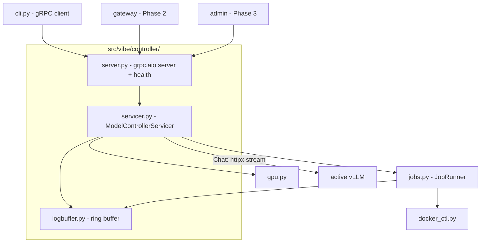

# 02 — gRPC Model Controller

> Phase 1 · Depends on: 00-foundation · Status: Implemented

## Summary

Wrap the Phase 0 `JobRunner`, `docker_ctl`, and `gpu` modules in a gRPC service (`vibe.v1.ModelController`)
on `127.0.0.1:50051`. The CLI becomes a thin gRPC client, and every later component (gateway, admin UI)
uses the same client. This is the only process that talks to Docker or NVML.

## Goals / Non-goals

**Goals**
- Long-lived controller process holding the single-model invariant and the in-flight job.
- Server-streaming RPCs for load/unload progress, logs, chat, and downloads.
- Stable, additive-only proto with committed generated code.
- Standard gRPC health checking so systemd/Caddy/UI can probe it.

**Non-goals**
- Authentication/authorization (loopback only in v1).
- HTTP/JSON transcoding of the gRPC API (rejected — gateway is a plain reverse proxy).
- Download RPC *implementation* (defined in the proto here, implemented in Phase 4).

## Requirements

### Functional

| ID | Requirement |
| --- | --- |
| FR-02.1 | `proto/vibe/v1/control.proto`, package `vibe.v1`, service `ModelController` with RPCs: `ListModels`, `GetStatus`, `LoadModel` (stream), `UnloadModel` (stream), `StreamLogs` (stream), `GetGpuStats`, `Chat` (stream), `ListDownloads`, `DownloadModel` (stream), `CancelDownload`. |
| FR-02.2 | Model states: `AVAILABLE, LOADING, READY, UNLOADING, ERROR`. `GetStatus` returns the active alias, its state, container info, and the current job (if any). |
| FR-02.3 | `LoadModel(alias, force)` streams `JobEvent`s until terminal state; a concurrent load returns `FAILED_PRECONDITION` with the in-flight job id. Unknown alias → `NOT_FOUND`. |
| FR-02.4 | `UnloadModel` streams `JobEvent`s; idempotent (no container → single `READY→AVAILABLE` no-op event). |
| FR-02.5 | `StreamLogs(tail, follow)` streams the active container's logs; if none, returns the ring-buffered logs of the last job (ADR-10). |
| FR-02.6 | `Chat(ChatRequest)` streams `ChatChunk`s by calling the active vLLM's `/v1/chat/completions` with `stream=true`. Used by the admin UI's `/chat` page (Phase 3), not by Zed. No model → `FAILED_PRECONDITION`. |
| FR-02.7 | `GetGpuStats` returns used/total MiB, utilization %, and compute processes. |
| FR-02.8 | Implements `grpc.health.v1.Health`; `SERVING` once the servicer is bound and Docker is reachable, `NOT_SERVING` if Docker ping fails. |
| FR-02.9 | `vibe serve --only controller` starts the controller alone. `vibe serve` (no flag) starts controller + gateway + admin in one asyncio loop (gateway/admin are no-ops until their phases land). |
| FR-02.10 | CLI commands `list, load, unload, status, logs` use the gRPC client; `vibe validate` stays local. If the controller is unreachable, the CLI prints how to start it and exits 1. |
| FR-02.11 | Client cancellation of `LoadModel` does **not** abort the job (the load continues; later `GetStatus`/`StreamLogs` show progress). Cancellation of `Chat` aborts the upstream vLLM request. |

### Non-functional

| ID | Requirement |
| --- | --- |
| NFR-02.1 | Proto is additive-only: never renumber; removed fields become `reserved`. |
| NFR-02.2 | Generated code lives in `src/vibe/gen/` and is committed; `make proto` regenerates with `grpcio-tools` and CI/pytest fails if output differs from the commit. |
| NFR-02.3 | `grpc.aio` server; no blocking Docker SDK calls on the event loop (wrap in `asyncio.to_thread`). |
| NFR-02.4 | Bind `${VIBE_BIND:-127.0.0.1}:50051`; insecure channel (no TLS) in v1. |
| NFR-02.5 | Streams emit a heartbeat `JobEvent(level=DEBUG)` at least every 10 s during long waits so clients can detect stalls. |

## Architecture

### Proto sketch

```proto
syntax = "proto3";
package vibe.v1;

service ModelController {
  rpc ListModels(ListModelsRequest) returns (ListModelsResponse);
  rpc GetStatus(GetStatusRequest) returns (Status);
  rpc LoadModel(LoadModelRequest) returns (stream JobEvent);
  rpc UnloadModel(UnloadModelRequest) returns (stream JobEvent);
  rpc StreamLogs(StreamLogsRequest) returns (stream LogLine);
  rpc GetGpuStats(GetGpuStatsRequest) returns (GpuStats);
  rpc Chat(ChatRequest) returns (stream ChatChunk);
  rpc ListDownloads(ListDownloadsRequest) returns (ListDownloadsResponse);
  rpc DownloadModel(DownloadModelRequest) returns (stream DownloadProgress);
  rpc CancelDownload(CancelDownloadRequest) returns (CancelDownloadResponse);
}

enum ModelState { MODEL_STATE_UNSPECIFIED = 0; AVAILABLE = 1; LOADING = 2; READY = 3; UNLOADING = 4; ERROR = 5; }

message ModelInfo {
  string alias = 1; string display_name = 2; string hf_repo = 3; string quantization = 4;
  uint32 max_model_len = 5; float gpu_memory_utilization = 6; uint32 host_port = 7;
  repeated string tags = 8; string use_case = 9; ModelState state = 10; bool cached_locally = 11;
}
message ListModelsRequest {}
message ListModelsResponse { repeated ModelInfo models = 1; }

message GetStatusRequest {}
message Status {
  string active_alias = 1; ModelState state = 2; string container_id = 3;
  uint32 host_port = 4; int64 started_at_unix = 5; Job current_job = 6; string last_error = 7;
}

enum JobKind { JOB_KIND_UNSPECIFIED = 0; LOAD = 1; UNLOAD = 2; DOWNLOAD = 3; }
message Job { string id = 1; JobKind kind = 2; string alias = 3; int64 started_at_unix = 4; bool done = 5; bool ok = 6; }
message JobEvent {
  string job_id = 1; int64 ts_unix_ms = 2; string level = 3; string message = 4;
  ModelState state = 5; float progress = 6; bool terminal = 7;
}

message LoadModelRequest { string alias = 1; bool force = 2; }
message UnloadModelRequest {}

message StreamLogsRequest { int32 tail = 1; bool follow = 2; }
message LogLine { int64 ts_unix_ms = 1; string line = 2; }

message GetGpuStatsRequest {}
message GpuProcess { uint32 pid = 1; string name = 2; uint32 used_mib = 3; }
message GpuStats { uint32 used_mib = 1; uint32 total_mib = 2; uint32 utilization_pct = 3; repeated GpuProcess processes = 4; }

message ChatMessage { string role = 1; string content = 2; }
message ChatRequest { string alias = 1; repeated ChatMessage messages = 2; float temperature = 3; uint32 max_tokens = 4; }
message ChatChunk { string delta = 1; string finish_reason = 2; uint32 prompt_tokens = 3; uint32 completion_tokens = 4; }

message ListDownloadsRequest {}
message DownloadInfo { string id = 1; string hf_repo = 2; repeated string include = 3; float progress = 4; uint64 bytes_done = 5; uint64 bytes_total = 6; bool done = 7; bool ok = 8; string error = 9; }
message ListDownloadsResponse { repeated DownloadInfo downloads = 1; }
message DownloadModelRequest { string hf_repo = 1; repeated string include = 2; string revision = 3; }
message DownloadProgress { string id = 1; float progress = 2; uint64 bytes_done = 3; uint64 bytes_total = 4; string current_file = 5; bool terminal = 6; string error = 7; }
message CancelDownloadRequest { string id = 1; }
message CancelDownloadResponse { bool cancelled = 1; }
```

### Components



### File layout

```
proto/vibe/v1/control.proto
src/vibe/gen/vibe/v1/control_pb2.py, control_pb2_grpc.py, control_pb2.pyi
src/vibe/controller/__init__.py
src/vibe/controller/server.py       # build_server(settings) -> grpc.aio.Server; health servicer
src/vibe/controller/servicer.py     # ModelControllerServicer(JobRunner, Registry, gpu)
src/vibe/controller/logbuffer.py    # RingBuffer(maxlen=2000) fed by jobs.py
src/vibe/client.py                  # ControllerClient: typed async wrapper used by CLI/gateway/admin
src/vibe/serve.py                   # `vibe serve [--only ...]` composition root
```

### Interfaces

- `ControllerClient(target="127.0.0.1:50051")` exposes `list_models()`, `status()`, `load(alias, force) -> AsyncIterator[JobEvent]`, `unload()`, `logs(tail, follow)`, `gpu()`, `chat(req) -> AsyncIterator[ChatChunk]`. Gateway and admin import **only** this.
- `jobs.JobEvent` ↔ `vibe.v1.JobEvent` mapping lives in `servicer.py` (`to_proto(event)`).

## Task breakdown

- [ ] **M1.1 — Proto + codegen (S)**: write `control.proto`, `make proto` target, commit `src/vibe/gen/`, pytest that regenerates to a temp dir and diffs.
- [ ] **M1.2 — Servicer: status/list/gpu (S)**: unary RPCs over Registry + docker_ctl + gpu; `cached_locally` computed by checking `HF_HOME/hub/models--<org>--<name>`.
- [ ] **M1.3 — Servicer: load/unload streams (M)**: wrap `JobRunner` generators; `FAILED_PRECONDITION` on concurrent job; detached-from-client continuation (FR-02.11).
- [ ] **M1.4 — Logs + ring buffer (S)**: `StreamLogs` follows container via `docker_ctl.logs` in a thread; falls back to ring buffer.
- [ ] **M1.5 — Chat stream (M)**: httpx SSE consumer of vLLM `/v1/chat/completions`, parse `data:` lines, map to `ChatChunk`, propagate cancellation.
- [ ] **M1.6 — Health + serve (S)**: `grpc_health.v1` servicer, Docker ping loop every 15 s, `vibe serve --only controller`, `deploy/vibe-controller.service` (systemd user unit, `After=docker.service`).
- [ ] **M1.7 — CLI cutover (S)**: `cli.py` uses `ControllerClient`; friendly error when controller down; `make serve` target.
- [ ] **M1.8 — Tests (M)**: in-process `grpc.aio` server with a fake `JobRunner`; cover FR-02.3, FR-02.4, FR-02.11, health transitions.

## Acceptance criteria

- `uv run vibe serve --only controller` starts; `grpc_health_probe -addr=127.0.0.1:50051` (or `grpcurl`) reports `SERVING`.
- `uv run vibe load qwen2.5-coder-7b` in another terminal streams events and exits 0; killing the CLI mid-load does not stop the load, and `vibe status` later shows `READY`.
- Running two `vibe load` concurrently: second exits 1 with `FAILED_PRECONDITION` naming the job id.
- `grpcurl -plaintext -d '{"alias":"qwen2.5-coder-7b","messages":[{"role":"user","content":"hi"}]}' 127.0.0.1:50051 vibe.v1.ModelController/Chat` streams deltas.
- `make proto` produces no diff on a clean tree; `uv run pytest` passes.
- `make qwen` / `make status` / `make stop` still work (via gRPC).

## Risks & open questions

- **grpcio wheels on Arch/Python 3.12**: prebuilt wheels exist; pin `grpcio`/`grpcio-tools` to the same version to avoid codegen drift.
- **Blocking Docker SDK** in an aio server — enforce `to_thread` via a small `docker_ctl` async façade and a lint rule (no direct `docker.` import outside `docker_ctl.py`).
- **Job continuation after client disconnect** requires the job to run as an `asyncio.Task` owned by the servicer, with the RPC stream subscribing to a fan-out queue. Design this in M1.3 up front so the admin UI's job page (Phase 3) can attach to an in-flight job.
- Open: expose `ReloadRegistry` RPC so `models.yaml` edits (Phase 4 registration flow) don't require restarting the controller? Proposed: yes, add in Phase 4 (additive).
