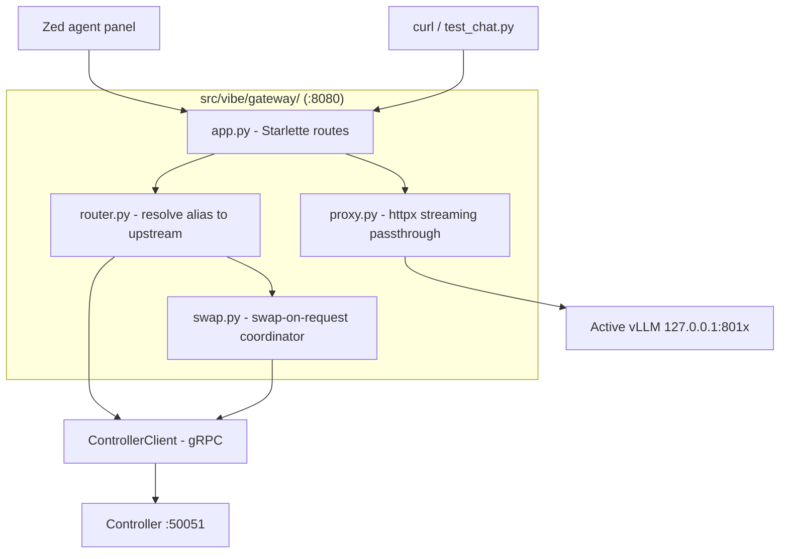
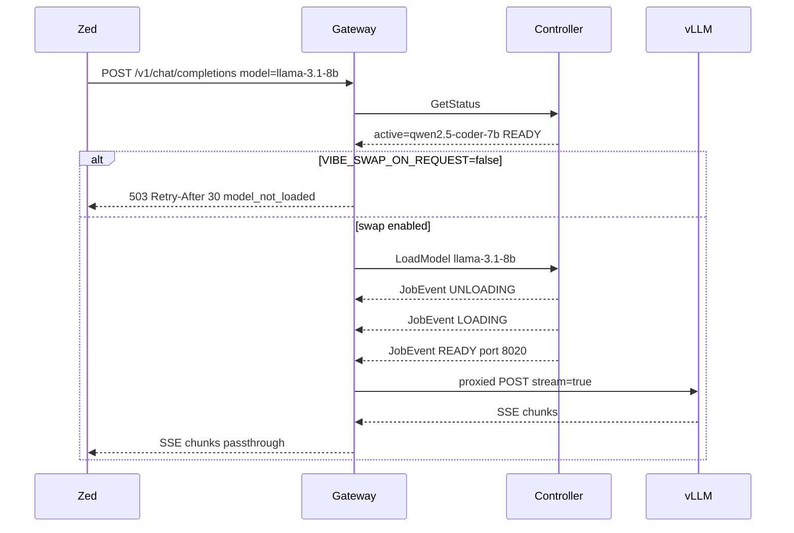

# 03 — OpenAI-Compatible Gateway (Zed integration)

> Phase 2 · Depends on: 02-grpc-server · Status: Implemented

> **Jev mode** (improvements-2, doc 03): when the controller has a Jev schema attached to the active
> model, the gateway injects `response_format: {type: json_schema, ...}` into `POST /v1/chat/completions`,
> rejects `tools`/`tool_choice` requests with `400 jev_incompatible_request`, and marks the active entry
> in `/v1/models` with `vibe_jev`. See
> [`.zed/docs/fable-5/improvements-2/03-gateway-enforcement.md`](../../fable-5/improvements-2/03-gateway-enforcement.md).

## Summary

A fixed-address OpenAI-compatible HTTP endpoint (`http://localhost:8080/v1`) that reverse-proxies to whichever
vLLM container is active. Clients — primarily Zed's agent panel — configure the gateway once and never care
which port the model happens to be on. The gateway asks the controller (gRPC) where traffic should go and,
optionally, asks it to swap models when a request names a non-active alias.

## Goals / Non-goals

**Goals**
- Zed works with a single `openai_compatible` provider entry, listing all registry aliases.
- Byte-for-byte passthrough of vLLM responses (including SSE streams and tool-call chunks).
- Clear behaviour when the requested model isn't loaded: `503 + Retry-After`, or opt-in swap-on-request.
- `/v1/models` that reflects the whole registry, not just the active model.

**Non-goals**
- Re-implementing OpenAI semantics (validation, token counting, tool parsing) — vLLM does that.
- HTTP/JSON transcoding of the gRPC control API.
- Authentication (loopback only; Zed's API key field accepts any string).
- Multi-model serving / routing across simultaneously loaded models.

## Requirements

### Functional

| ID | Requirement |
| --- | --- |
| FR-03.1 | Serves on `${VIBE_BIND:-127.0.0.1}:8080`. Paths: `GET /v1/models`, `POST /v1/chat/completions`, `POST /v1/completions`, `POST /v1/embeddings`, `GET /health`. Unknown `/v1/*` paths return `404` with an OpenAI-style error body. |
| FR-03.2 | `GET /v1/models` returns every registry alias as an OpenAI `model` object (`id=alias`, `owned_by="vibe"`) with extension fields `vibe_state`, `vibe_display_name`, `vibe_max_model_len`, `vibe_active: bool`. |
| FR-03.3 | For POST routes, the gateway reads the request JSON `model` field. If it equals the active alias and state is `READY`, the request is proxied to `http://127.0.0.1:<host_port>` with the same path, headers (minus hop-by-hop), and body. |
| FR-03.4 | Streaming responses (`stream: true`) are relayed as they arrive with `Content-Type: text/event-stream`, no buffering, no re-serialization. |
| FR-03.5 | If `model` is a known alias but not active: when `VIBE_SWAP_ON_REQUEST=false` (default) return `503` with `Retry-After: 30` and body `{"error":{"message":"model X is not loaded (active: Y). Run: vibe load X","type":"model_not_loaded","code":"model_not_loaded"}}`. |
| FR-03.6 | When `VIBE_SWAP_ON_REQUEST=true`: call `LoadModel(alias)`, hold the request up to `VIBE_SWAP_TIMEOUT` (default 180 s), then proxy. Concurrent requests for the same alias attach to the in-flight job; requests for a *different* alias during a swap get `503` immediately. |
| FR-03.7 | Unknown `model` → `404` with `type: "model_not_found"` and the list of valid aliases. Missing `model` field → `400`. |
| FR-03.8 | If the active vLLM is `LOADING`/`UNLOADING`, return `503` + `Retry-After: 10` (do not queue). |
| FR-03.9 | Upstream connection failures (container died) → `502` and the gateway triggers a `GetStatus` refresh; it never caches stale routing for more than 5 s. |
| FR-03.10 | `GET /health` → `{"gateway":"ok","controller":"ok|down","active":"<alias>|null","state":"..."}` with `200` if gateway is up regardless of model state. While the controller is down, `state` is `null` (IMP-03.10). |
| FR-03.11 | `scripts/test_chat.py` rewritten to target `http://localhost:8080/v1` and accept `--model <alias>` (defaults to the active one from `/v1/models`). |

### Non-functional

| ID | Requirement |
| --- | --- |
| NFR-03.1 | Streaming first-token latency overhead ≤ 20 ms vs. hitting vLLM directly (measured locally). |
| NFR-03.2 | Gateway holds no model state of its own; routing = `GetStatus` result cached ≤ 5 s + invalidated on 502. |
| NFR-03.3 | Imports only `ControllerClient`, `httpx`, and an ASGI framework (Starlette/FastAPI) + `uvicorn`. No `docker`, no `pynvml`. |
| NFR-03.4 | Request bodies up to 32 MiB (large contexts) streamed to upstream without full buffering where possible; the `model` field is read from the first chunk or a bounded prefix. |
| NFR-03.5 | Default hop-by-hop headers (`Connection`, `Transfer-Encoding`, `Keep-Alive`) stripped; `Authorization` forwarded as-is (vLLM ignores it unless `--api-key` is set). |

## Architecture

### Components



### Request flow (swap-on-request enabled)



### Routing decision table

| `model` field | Active state | Result |
| --- | --- | --- |
| = active alias | `READY` | proxy |
| = active alias | `LOADING`/`UNLOADING` | 503, `Retry-After: 10` |
| other known alias | any, swap off | 503, `Retry-After: 30`, `model_not_loaded` |
| other known alias | any, swap on, no job | `LoadModel` → wait → proxy (or 504 on timeout) |
| other known alias | swap on, job for **same** alias | attach to job → proxy |
| other known alias | swap on, job for **different** alias | 503, `Retry-After: 30` |
| unknown | — | 404 `model_not_found` |
| missing | — | 400 |
| controller down | — | 503 `Retry-After: 5`, body `{"error":{"message":"controller unreachable","type":"controller_unavailable","code":"controller_unavailable"}}` (IMP-03.14) |

### File layout

```
src/vibe/gateway/__init__.py
src/vibe/gateway/app.py        # build_app(settings, client) -> Starlette
src/vibe/gateway/router.py     # RouteDecision = Proxy(upstream) | Retry(status, after, error) | Swap(alias)
src/vibe/gateway/proxy.py      # stream_proxy(request, upstream_base) using httpx.AsyncClient(stream=True)
src/vibe/gateway/swap.py       # SwapCoordinator: one in-flight alias, awaiters attach, timeout → 504
src/vibe/gateway/models.py     # /v1/models aggregation from ListModels + GetStatus
deploy/Caddyfile               # optional TLS front (8443 → 8080, 8444 → 8081), tls internal
```

### Zed configuration

Add to `.zed/settings.json` (project) or global `settings.json`. Verify field names against the current
Zed docs at https://zed.dev/docs/ai/llm-providers — the OpenAI-compatible provider schema has changed
across releases. The API key is entered in Zed's provider settings UI; any non-empty string (e.g. `local`) works.

```json
{
  "language_models": {
    "openai_compatible": {
      "vibe-local": {
        "api_url": "http://localhost:8080/v1",
        "available_models": [
          {
            "name": "qwen2.5-coder-7b",
            "display_name": "Qwen2.5 Coder 7B (local vLLM)",
            "max_tokens": 32768,
            "max_output_tokens": 4096,
            "max_completion_tokens": 4096,
            "capabilities": { "tools": true, "images": false, "parallel_tool_calls": false, "prompt_cache_key": false }
          },
          {
            "name": "llama-3.1-8b",
            "display_name": "Llama 3.1 8B (local vLLM)",
            "max_tokens": 16384,
            "max_output_tokens": 4096,
            "max_completion_tokens": 4096,
            "capabilities": { "tools": true, "images": false, "parallel_tool_calls": false, "prompt_cache_key": false }
          },
          {
            "name": "deepseek-r1-14b",
            "display_name": "DeepSeek R1 14B (local vLLM)",
            "max_tokens": 7984,
            "max_output_tokens": 2048,
            "max_completion_tokens": 2048,
            "capabilities": { "tools": false, "images": false, "parallel_tool_calls": false, "prompt_cache_key": false }
          }
        ]
      }
    }
  },
  "agent": {
    "default_model": { "provider": "vibe-local", "model": "qwen2.5-coder-7b" }
  }
}
```

Notes:
- `max_tokens` here should equal the registry `max_model_len`; keep them in sync (Phase 4 may add `vibe zed-settings` to print this block from `models.yaml`).
- Tool calling depends on vLLM flags in `extra_args`: Qwen → `--enable-auto-tool-choice --tool-call-parser hermes`; Llama → `--tool-call-parser llama3_json`. DeepSeek R1 distill: `tools: false`.
- Zed's agent sends `model` = the `name`; because alias = `--served-model-name`, no translation is needed.

### Optional TLS (Caddy)

`deploy/Caddyfile`:

```
localhost:8443 { tls internal; reverse_proxy 127.0.0.1:8080 }
localhost:8444 { tls internal; reverse_proxy 127.0.0.1:8081 }
```

Off by default; only relevant if `VIBE_BIND` is ever widened beyond loopback.

## Task breakdown

- [x] **M2.1 — App skeleton + /health + /v1/models (S)**: Starlette app, `ControllerClient` wiring, aggregation per FR-03.2.
- [x] **M2.2 — Streaming proxy (M)**: `proxy.py` with httpx `stream=True`, header filtering, SSE passthrough, 502 on upstream failure with routing cache invalidation.
- [x] **M2.3 — Router (M)**: decision table above as pure functions with unit tests; body prefix parsing for `model`.
- [x] **M2.4 — Swap coordinator (M)**: attach/await semantics, `VIBE_SWAP_TIMEOUT` → 504, different-alias rejection.
- [x] **M2.5 — serve integration (S)**: `vibe serve` mounts gateway alongside controller; `--only gateway`; `deploy/vibe-gateway.service`.
- [x] **M2.6 — Zed + tooling (S)**: documented settings snippet in repo `README.md`, rewrite `scripts/test_chat.py` (FR-03.11), `make chat` target.
- [x] **M2.7 — Caddy (S, optional)**: `deploy/Caddyfile`, `make tls` to run Caddy in Docker.
- [x] **M2.8 — Tests (M)**: fake upstream ASGI app emitting SSE; assert byte equality of relayed stream; decision-table cases; swap attach/timeouts with a fake client.

## Acceptance criteria

- With `vibe serve` running and `qwen2.5-coder-7b` loaded, Zed's agent panel (provider `vibe-local`, model `qwen2.5-coder-7b`) completes a streamed chat and at least one tool call (e.g. read a file).
- `curl localhost:8080/v1/models` lists three aliases with exactly one `vibe_active: true`.
- Selecting `llama-3.1-8b` in Zed with swap off yields a visible error containing `vibe load llama-3.1-8b`; with swap on, the request succeeds after the swap and `vibe status` shows llama active.
- `diff <(curl -N direct-vllm …) <(curl -N gateway …)` on a non-streaming request: identical bodies.
- `uv run python scripts/test_chat.py --model qwen2.5-coder-7b` streams output via 8080.
- `uv run pytest` passes; `make qwen` / `make stop` unaffected.

## Risks & open questions

- **Zed provider schema drift**: the snippet must be re-verified against Zed docs at implementation time; keep it in one place (README) and reference it from here.
- **Zed timeouts during swap-on-request**: a 60–120 s cold start may exceed Zed's HTTP client timeout. Default swap **off**; document that swapping should be done via CLI/admin UI first. Consider emitting SSE comment keepalives (`: waiting\n\n`) during the swap if `stream: true` — verify Zed tolerates them.
- **Reading `model` from a streamed body** while still forwarding the body: simplest is to buffer the body (bounded, 32 MiB) — accept this in v1.
- **vLLM `--api-key`** not set in v1; if it is later, gateway must inject the key rather than forwarding Zed's placeholder.
- Open: should `/v1/models` hide aliases whose weights aren't cached locally (`cached_locally=false`)? Proposed: include them but mark `vibe_cached: false`.
