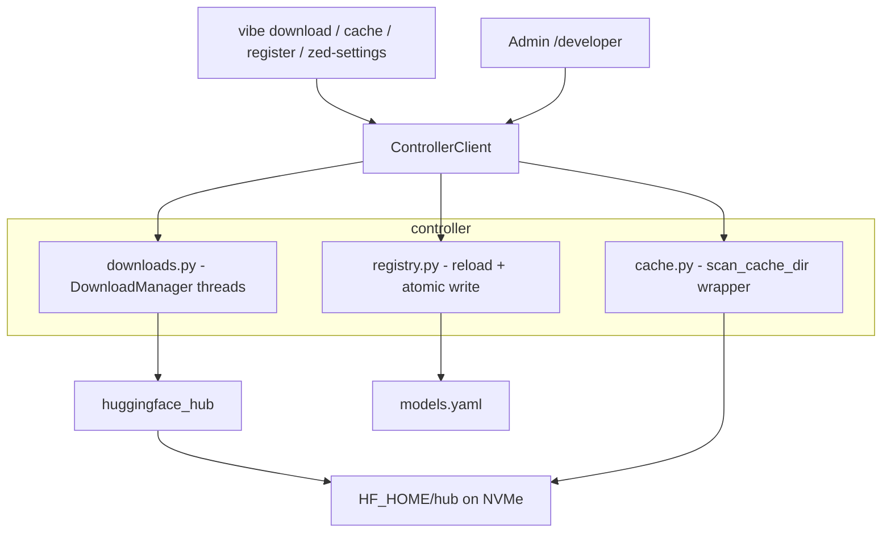
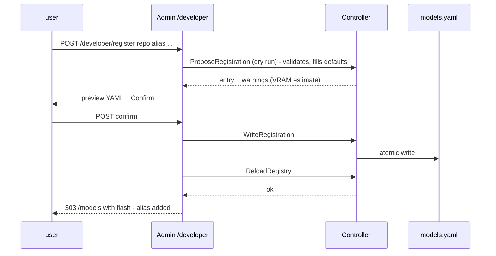

# 04 — Model Downloads & Developer Page

> Phase 4 · Depends on: 02-grpc-server, 01-admin-ui · Status: Implemented

## Summary

First-class model acquisition: download Hugging Face repos (full or filtered, e.g. a single GGUF file) into the
shared `HF_HOME`, watch progress, inspect what's on disk, and register a downloaded repo as a new `models.yaml`
entry without hand-editing YAML. Exposed via the `DownloadModel`/`ListDownloads`/`CancelDownload` RPCs
(defined in Phase 1, implemented here), the `vibe download` CLI, and the admin `/developer` page.

## Goals / Non-goals

**Goals**
- Pre-download weights so `vibe load` never waits on the network.
- Filtered downloads (`--include`) for GGUF repos where only one quant is wanted.
- Visibility into the HF cache: what's present, sizes, disk free.
- Guided registration: repo → validated `models.yaml` entry with sensible defaults for a 16 GB card.
- Hot-reload the registry so the controller/gateway/UI see new aliases without restart.

**Non-goals**
- Converting or quantizing models (Phase 5 `export.py`).
- Serving GGUF via vLLM in v1 (vLLM's GGUF support is experimental; GGUF is a lab-side format here).
- Deleting arbitrary cache entries from the UI beyond a per-repo "remove" with confirmation.

## Requirements

### Functional

| ID | Requirement |
| --- | --- |
| FR-04.1 | `DownloadModel(hf_repo, include[], revision)` runs `huggingface_hub.snapshot_download(repo_id, allow_patterns=include, revision, token=HF_TOKEN, cache_dir=HF_HOME/hub)` in a worker thread and streams `DownloadProgress` (bytes done/total, current file, %). Multiple downloads may run concurrently (max 2); duplicates of an in-flight repo attach to it. |
| FR-04.2 | `ListDownloads` returns in-flight and recently completed (last 20) downloads. `CancelDownload(id)` stops the thread cooperatively; partial files remain in HF's incomplete blobs dir (resumable). |
| FR-04.3 | `vibe download <hf_repo> [--include PATTERN ...] [--revision REV]` streams progress to the terminal; exit 0/1. `vibe downloads` lists. |
| FR-04.4 | `vibe cache list [--json]` lists cached repos with size on disk, last-modified, and whether a registry alias points at it. `vibe cache rm <repo>` removes after confirmation. `vibe cache du` prints total and free space on the `HF_HOME` filesystem. |
| FR-04.5 | `vibe register <hf_repo> --alias <alias> [--quantization awq|gptq|none] [--max-model-len N] [--gpu-mem N] [--port N] [--tool-parser hermes|llama3_json] [--use-case ...] [--tags ...]` appends a validated entry to `models.yaml`. Defaults: next free port in 8010–8099, container `vibe-<alias>`, `gpu_memory_utilization` per size heuristic table below, `max_model_len` from the repo's `config.json` capped at 32768. |
| FR-04.6 | `ReloadRegistry` RPC (additive) re-reads `models.yaml`; controller validates first and returns errors without swapping the live registry on failure. Gateway `/v1/models` and admin `/models` reflect the change on next request. |
| FR-04.7 | Admin `/developer` page: (a) downloads section — form `repo, include patterns, revision` → POST → 303 `/developer/downloads/<id>` (meta-refresh 2 s, progress bar via CSS width, Cancel button); (b) HF cache browser — table of repos, size, alias link, Remove (confirm page); (c) disk usage summary; (d) register form pre-filled from a cached repo → POST `/developer/register` → validates → shows resulting YAML snippet + "Reload registry" button; (e) read-only `<pre>` of the Zed `openai_compatible` settings block generated from the registry. |
| FR-04.8 | `vibe zed-settings` prints the Zed JSON block (Phase 2 shape) from `models.yaml` so the two never drift by hand. |
| FR-04.9 | `ListModels.cached_locally` (Phase 1) is computed by the same cache scanner used here; the `/models` page shows a Download button for uncached aliases that POSTs to the download flow. |

### Non-functional

| ID | Requirement |
| --- | --- |
| NFR-04.1 | Downloads use `huggingface_hub` only (already a transitive need); `hf_transfer` optional via env `HF_HUB_ENABLE_HF_TRANSFER=1`. |
| NFR-04.2 | Cache scanning uses `huggingface_hub.scan_cache_dir`; cached for 30 s to keep `/developer` snappy on a 4 TB volume. |
| NFR-04.3 | `models.yaml` writes are atomic (write temp + rename) and preserve comments/ordering where feasible (use `ruamel.yaml` round-trip, or append-only block with a marker comment if ruamel is undesirable). |
| NFR-04.4 | Registry validation errors from `register`/`ReloadRegistry` list every violation. |
| NFR-04.5 | No JS on `/developer` (inherits NFR-01.1). |

## Architecture

### Components



### Register flow



### Default heuristics for a 16 GB card (used by `register`)

| Detected weights on disk | `gpu_memory_utilization` | Suggested `max_model_len` cap |
| --- | --- | --- |
| ≤ 3 GB (≤3B fp16 / 7B 4-bit small) | 0.60 | 32768 |
| 3–6 GB (7–8B AWQ/GPTQ) | 0.70–0.75 | 32768 |
| 6–10 GB (13–14B AWQ) | 0.85 | 8192 |
| > 10 GB | refuse with message | — |

Weight size = sum of `*.safetensors` in the snapshot. Warn if `config.json` lacks `quantization_config` but `--quantization` was given, and vice versa.

### GGUF vs safetensors

| Format | Serving in this project | Where |
| --- | --- | --- |
| safetensors (AWQ/GPTQ/fp16) | vLLM via `models.yaml` | `HF_HOME/hub` |
| GGUF (`Q4_K_M` etc.) | **Not** registered for vLLM in v1; used by `laboratory/inference_gguf.py` | `HF_HOME/hub` (downloaded with `--include "*Q4_K_M.gguf"`) or `laboratory/models/` |

`vibe register` rejects repos whose snapshot contains only `.gguf` files with a pointer to Phase 5.

### Proto additions (additive)

```proto
rpc ReloadRegistry(ReloadRegistryRequest) returns (ReloadRegistryResponse);   // errors[] on failure
rpc ListCache(ListCacheRequest) returns (ListCacheResponse);                   // repos, sizes, alias refs, disk free
rpc RemoveCached(RemoveCachedRequest) returns (RemoveCachedResponse);
rpc ProposeRegistration(ProposeRegistrationRequest) returns (ProposeRegistrationResponse); // dry run
rpc WriteRegistration(WriteRegistrationRequest) returns (WriteRegistrationResponse);
```

### File layout

```
src/vibe/controller/downloads.py    # DownloadManager: ThreadPool(2), progress via tqdm_class hook, cancel flag
src/vibe/controller/cache.py        # scan (cached 30 s), sizes, alias cross-reference, disk free (shutil.disk_usage)
src/vibe/registry.py                # + propose(), write_entry() atomic, reload()
src/vibe/zedsettings.py             # registry -> Zed openai_compatible JSON
src/vibe/admin/routes/developer.py  # sections (a)-(e)
src/vibe/admin/templates/developer.html, download.html, register_preview.html, cache_rm_confirm.html
```

## Task breakdown

- [x] **M4.1 — DownloadManager + RPCs (M)**: thread pool, progress hook (custom `tqdm` subclass forwarding to an asyncio queue), cancel, attach-to-in-flight, `ListDownloads`.
- [x] **M4.2 — CLI download/downloads (S)**: streaming progress bar in terminal (`rich` optional).
- [x] **M4.3 — Cache scanner + CLI (S)**: `ListCache`/`RemoveCached`, `vibe cache list|rm|du`, feed `cached_locally`.
- [x] **M4.4 — Registry write/reload (M)**: `ruamel.yaml` round-trip, atomic write, `ReloadRegistry` with validate-before-swap; `Propose`/`Write` RPCs; heuristics table; `vibe register`.
- [x] **M4.5 — `vibe zed-settings` (S)**: JSON generator; unit test against the Phase 2 snippet shape.
- [x] **M4.6 — /developer page (M)**: downloads form + progress page, cache table + confirm remove, register preview/confirm, Zed settings `<pre>`, disk usage.
- [x] **M4.7 — /models Download button (S)**: for uncached aliases.
- [x] **M4.8 — Tests (M)**: fake `snapshot_download` with synthetic progress; registry write preserves comments; heuristics; reload rejects invalid YAML and keeps old registry.

## Acceptance criteria

- `uv run vibe download Qwen/Qwen2.5-Coder-1.5B-Instruct` shows progress and exits 0; a second run is instant (cache hit).
- `uv run vibe download bartowski/Qwen2.5-Coder-7B-Instruct-GGUF --include "*Q4_K_M.gguf"` downloads exactly one `.gguf`.
- `/developer` lists the cache with sizes and free space, and the download page updates every 2 s until done; Cancel stops a large download.
- `uv run vibe register Qwen/Qwen2.5-Coder-1.5B-Instruct --alias qwen2.5-coder-1.5b` appends a valid entry, `vibe validate` passes, and `/v1/models` on 8080 lists the new alias without restarting `vibe serve`.
- Registering an invalid alias or a duplicate port fails with all errors listed and leaves `models.yaml` untouched.
- `uv run vibe zed-settings | jq .` succeeds and lists every alias.
- `uv run pytest` passes.

## Risks & open questions

- **`snapshot_download` progress granularity**: it reports per-file via tqdm; total bytes require a preliminary `HfApi.model_info(files_metadata=True)` call — do that first so the bar is meaningful.
- **Cancellation** is cooperative; a large single file may take seconds to stop. Acceptable.
- **ruamel vs pyyaml**: ruamel preserves comments but adds a dependency; decide in M4.4. Fallback: append a marked block at the end (`# --- added by vibe register ---`).
- **Gated repos** (Llama): surface HF 401/403 as a clear "check HF_TOKEN / accept license" message.
- Open: allow `register` to point at a local directory (Phase 5 exports) rather than an HF repo? Proposed: yes — `hf_repo` may be an absolute path under `laboratory/models/`, mounted into the container at the same path (needed for the Phase 5 round-trip).
