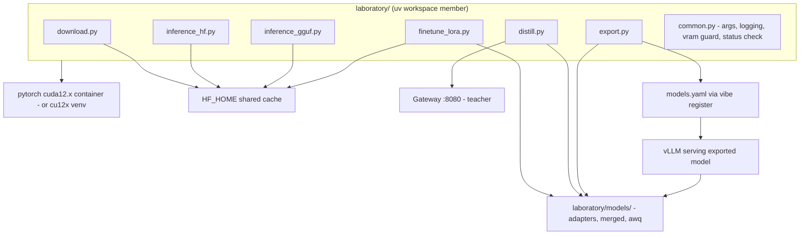
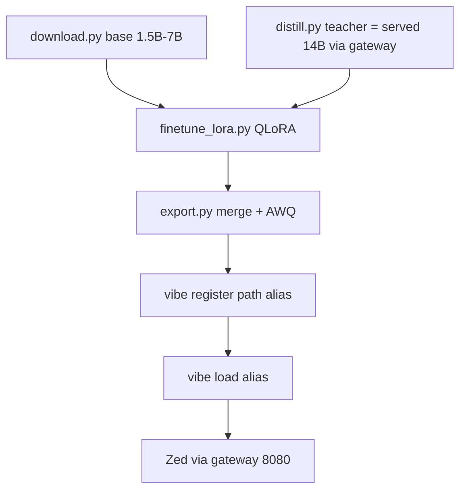

# 05 — Laboratory Workflow

> Phase 5 · Depends on: 00-foundation, 03-openai-gateway, 04-model-scripts · Status: Implemented
>
> **Pending GPU verification** (doc 05 fixes landed, doc 07 §D runbook not yet run on the target machine):
> - bitsandbytes/autoawq kernel smoke tests (D4/D5) — the "known-good" claim below is provisional until then.
> - Peak-VRAM numbers for the estimator table (IMP-05.10 `estimate_vs_peak` recording).
> - The AWQ decision (keep autoawq / switch to llmcompressor / drop) per `laboratory/README.md`'s decision tree.

## Summary

A `laboratory/` workspace for hands-on experiments that need PyTorch: running small models directly with
`transformers`, loading GGUF files, QLoRA fine-tuning a 7B model, distilling from a served teacher into a small
student, and exporting the result back into `models.yaml` so vLLM can serve it. The lab is a separate uv
workspace member so the control plane stays torch-free (ADR-1), and it runs inside a CUDA 12.x container
because the host has CUDA 13.3 and a rolling toolchain.

## Goals / Non-goals

**Goals**
- Reproducible torch environment isolated from the host's CUDA 13.3 userland.
- Six scripts covering download → inference → fine-tune → distill → export.
- Shared `HF_HOME` with the serving containers; artifacts under `laboratory/models/`.
- A documented VRAM budget so experiments are planned, not guessed.
- Round trip: exported model → `vibe register` → `vibe load` → usable from Zed.

**Non-goals**
- Full-parameter fine-tuning (does not fit 16 GB for ≥7B).
- Training data curation tooling beyond JSONL loaders.
- Multi-GPU or distributed anything.
- Serving GGUF via vLLM (GGUF stays lab-side; `llama-cpp-python` for local inference).

## Requirements

### Functional

| ID | Requirement |
| --- | --- |
| FR-05.1 | `laboratory/pyproject.toml` is a uv workspace member (`[tool.uv.workspace] members = ["laboratory"]` at root). Dependencies: `torch` (cu12x index), `transformers`, `accelerate`, `peft`, `trl`, `datasets`, `bitsandbytes`, `autoawq`, `llama-cpp-python` (optional extra), `huggingface_hub`, `safetensors`. |
| FR-05.2 | `laboratory/Dockerfile` based on `pytorch/pytorch:<ver>-cuda12.x-cudnn-devel`, installs uv and syncs the lab project. `make lab` runs it with `--gpus all`, mounts `laboratory/` → `/lab` and `HF_HOME` → `/root/.cache/huggingface`, sets `HF_TOKEN`, drops into a shell. `make lab-run CMD="python inference_hf.py ..."` runs a single command. |
| FR-05.3 | Alternative host venv: `uv sync --project laboratory` with `torch` from `https://download.pytorch.org/whl/cu124` (or current cu12x) — documented as "works while driver ≥ CUDA 12.x compat; container is the supported path". |
| FR-05.4 | `download.py <repo> [--include ...] [--revision]` — thin wrapper over `snapshot_download` into `HF_HOME` (same location Phase 4 uses); prints local path. |
| FR-05.5 | `inference_hf.py --model <repo or path> [--dtype bf16|fp16] [--load-in-4bit] [--prompt ...] [--chat]` — `transformers` generate with streaming to stdout; auto-selects 4-bit bnb for models > 3B unless overridden; prints tokens/s and peak VRAM. |
| FR-05.6 | `inference_gguf.py --gguf <path or repo:file> [--backend transformers|llamacpp] [--n-gpu-layers -1]` — loads GGUF via `transformers` (`gguf_file=`) or `llama-cpp-python`; same prompt/chat/metrics interface. |
| FR-05.7 | `finetune_lora.py --base <repo> --data <jsonl> --out laboratory/models/<name>-lora [--qlora] [--r 16] [--alpha 32] [--epochs N] [--max-seq-len 2048] [--grad-accum N]` — PEFT + TRL `SFTTrainer`; JSONL with `messages` (chat) or `prompt`/`completion`; saves adapter + training log; resumable from checkpoint. |
| FR-05.8 | `distill.py --teacher-alias <alias> --student <repo> --prompts <jsonl> --out laboratory/models/<name>-distill [--n N] [--temperature T]` — step 1: generates teacher outputs by calling the **gateway** (`http://localhost:8080/v1`, model=alias; uses swap-on-request or requires the alias loaded); caches to `laboratory/data/<name>.teacher.jsonl`; step 2: SFT the student on the generated pairs (reuses `finetune_lora.py` internals). |
| FR-05.9 | `export.py --adapter <dir> --base <repo> --out laboratory/models/<name> [--awq] [--register --alias <alias>]` — merges LoRA into base, saves safetensors + tokenizer; optional AWQ quantization via `autoawq` (calibration set: 128 samples from the training data); `--register` calls `vibe register` with `hf_repo=<absolute path>` (Phase 4 local-path support). |
| FR-05.10 | All scripts accept `--seed`, log to `laboratory/runs/<timestamp>-<script>/` (args, metrics, stdout), and print peak VRAM (`torch.cuda.max_memory_allocated`). |
| FR-05.11 | `laboratory/models/`, `laboratory/data/`, `laboratory/runs/` are gitignored and dockerignored. A `laboratory/README.md` explains the container/venv choice and the VRAM table. |

### Non-functional

| ID | Requirement |
| --- | --- |
| NFR-05.1 | Root `uv sync` (control plane) must **not** install torch; `uv sync --all-packages` or `--project laboratory` does. |
| NFR-05.2 | Container image tag pinned (`pytorch/pytorch:2.x.y-cuda12.x-cudnn9-devel`) in `laboratory/Dockerfile` and `.env.example` as `LAB_IMAGE_TAG`. |
| NFR-05.3 | Scripts refuse to start if the estimated VRAM (table below) exceeds free VRAM by > 10 %, unless `--force`. |
| NFR-05.4 | Lab and serving must not run simultaneously on the GPU by default: scripts call `vibe status` (or `GetStatus`) and warn/abort if a model is `READY` unless `--allow-coexist`. |

## Architecture

### Components



### Round trip



### VRAM budget (16 GB card, ~830 MiB desktop overhead, ~15 GB usable)

| Task | Model size | Precision | Est. VRAM | Fits? |
| --- | --- | --- | --- | --- |
| Inference | 1.5–3B | bf16/fp16 | 3–7 GB | yes |
| Inference | 7B | fp16 | ~14.5 GB + KV | **no** (use 4-bit) |
| Inference | 7B | 4-bit (bnb/AWQ) | 4.5–5.5 GB + KV | yes |
| Inference | 14B | 4-bit AWQ | ~9 GB + KV | yes (short ctx) |
| GGUF inference | 7B Q4_K_M | llama.cpp | ~5 GB | yes |
| LoRA (no quant) | ≤3B | bf16 | 8–12 GB | yes (bs 1–2, seq 2048) |
| QLoRA | 7B | 4-bit base + bf16 adapters | 10–12 GB | yes (bs 1, seq 2048, grad ckpt) |
| QLoRA | 14B | 4-bit | 16+ GB | **no** |
| AWQ quantization | 7B | fp16 load required | ~14.5 GB | borderline — use `--device-map auto` with CPU offload; slow |
| Distill teacher | 14B AWQ via vLLM | — | 9 GB (in vLLM) | yes, but not concurrently with student training |

Implication for `distill.py`: teacher generation and student training are **sequential** phases; step 1 requires the teacher loaded (via `vibe load`), step 2 requires it unloaded (`vibe unload`) — the script prompts for this or does it when `--auto-swap` is passed (calls the CLI).

### Container vs venv

| | Container (`make lab`) | Host venv (`uv sync --project laboratory`) |
| --- | --- | --- |
| CUDA userland | 12.x from image; driver 13.3 is backward compatible | cu12x wheels; relies on same driver compat |
| Risk on rolling OS | low — pinned image | medium — system python/glibc updates |
| bitsandbytes/autoawq wheels | pending GPU verification (doc 07 D4/D5); do not assume known-good yet | may need rebuild after system updates |
| Convenience | one extra shell | direct editor integration |
| **Recommendation** | **default** | opt-in for quick iteration |

### File layout

```
laboratory/
  pyproject.toml          # workspace member; torch cu12x index config
  Dockerfile              # pytorch/pytorch:<pinned>-cuda12.x-cudnn-devel + uv
  README.md               # setup, VRAM table, examples
  common.py               # arg parsing, run dirs, vram_guard(), serving_guard()
  download.py  inference_hf.py  inference_gguf.py  finetune_lora.py  distill.py  export.py
  data/                   # gitignored: jsonl datasets, teacher outputs
  models/                 # gitignored + dockerignored: adapters, merged, awq exports, gguf
  runs/                   # gitignored: per-run logs/metrics
Makefile                  # + lab, lab-run, lab-build targets
.dockerignore             # laboratory/models, laboratory/runs, laboratory/data
```

## Task breakdown

- [x] **M5.1 — Workspace + container (M)**: root workspace config, `laboratory/pyproject.toml` with cu12x index, `Dockerfile`, `make lab|lab-run|lab-build`, `.gitignore`/`.dockerignore`, verify root `uv sync` stays torch-free.
- [x] **M5.2 — common.py + download.py + inference_hf.py (M)**: run dirs, VRAM guard, serving guard, streaming generate, metrics; validate on Qwen2.5-Coder-1.5B (bf16) and 7B (4-bit).
- [x] **M5.3 — inference_gguf.py (S)**: `transformers gguf_file=` path and `llama-cpp-python` path; validate on the Phase 4 Q4_K_M download.
- [x] **M5.4 — finetune_lora.py (L)**: TRL SFT with PEFT, QLoRA config (nf4, double quant, bf16 compute), gradient checkpointing, checkpoint resume, JSONL formats; smoke run on 1.5B with 200 samples.
- [x] **M5.5 — distill.py (M)**: gateway client with concurrency 4, resumable teacher cache, then SFT via M5.4; `--auto-swap` orchestration through `vibe` CLI.
- [x] **M5.6 — export.py (M)**: merge_and_unload → safetensors, optional AWQ via autoawq with CPU offload, `--register` → `vibe register <abs path>`; ensure vLLM container mounts `laboratory/models` read-only when `hf_repo` is a local path (small change in `docker_ctl.start`).
- [x] **M5.7 — Docs + examples (S)**: `laboratory/README.md`, an end-to-end example (1.5B QLoRA on a tiny coding-style dataset → export → register → Zed).

## Acceptance criteria

- `uv sync` at root installs no torch; `make lab-build && make lab` opens a shell where `python -c "import torch; print(torch.cuda.is_available())"` prints `True`.
- `inference_hf.py --model Qwen/Qwen2.5-Coder-1.5B-Instruct --prompt "..."` streams output and reports peak VRAM < 5 GB.
- `inference_hf.py --model Qwen/Qwen2.5-Coder-7B-Instruct` auto-selects 4-bit and completes; without `--load-in-4bit --force`, fp16 is refused by the VRAM guard.
- `inference_gguf.py` runs the Q4_K_M file downloaded in Phase 4.
- `finetune_lora.py --qlora --base Qwen/Qwen2.5-Coder-7B-Instruct --data small.jsonl --epochs 1` completes on 16 GB with peak VRAM ≤ 12.5 GB and produces an adapter.
- `distill.py --teacher-alias deepseek-r1-14b --student Qwen/Qwen2.5-Coder-1.5B-Instruct --n 200` produces a teacher JSONL and an adapter.
- `export.py --adapter ... --awq --register --alias qwen-coder-1.5b-lab` → `vibe load qwen-coder-1.5b-lab` reaches `READY`, and Zed completes a chat against it via 8080.
- Running any lab script while a model is `READY` aborts with a clear message unless `--allow-coexist`.

## Risks & open questions

- **CUDA 13.3 driver + CUDA 12.x userland**: forward-compat is standard, but verify `bitsandbytes` and `autoawq` kernels load on sm_89 inside the chosen image before committing to the tag.
- **AWQ of a 7B needs fp16 weights in memory** (~14.5 GB): use `device_map="auto"` with CPU offload (32 GB RAM is enough) — slow but feasible; alternatively export unquantized and serve small (≤3B) models fp16 in vLLM.
- **vLLM tokenizer/chat-template compatibility** for exported models: `export.py` must copy `tokenizer_config.json` (including `chat_template`) and `generation_config.json`; otherwise tool calling and chat formatting break in the gateway.
- **Serving + training contention**: guard is advisory; both processes on one 16 GB card will OOM. Document `vibe unload` before training.
- **`llama-cpp-python` CUDA build** inside the container needs `CMAKE_ARGS="-DGGML_CUDA=on"`; keep it an optional extra to avoid slowing the default image build.
- Open: should distillation use logits (true KD) instead of text SFT? vLLM can return `logprobs` (top-k) but not full distributions; v1 = text SFT, note logprob-weighted loss as a future experiment.
