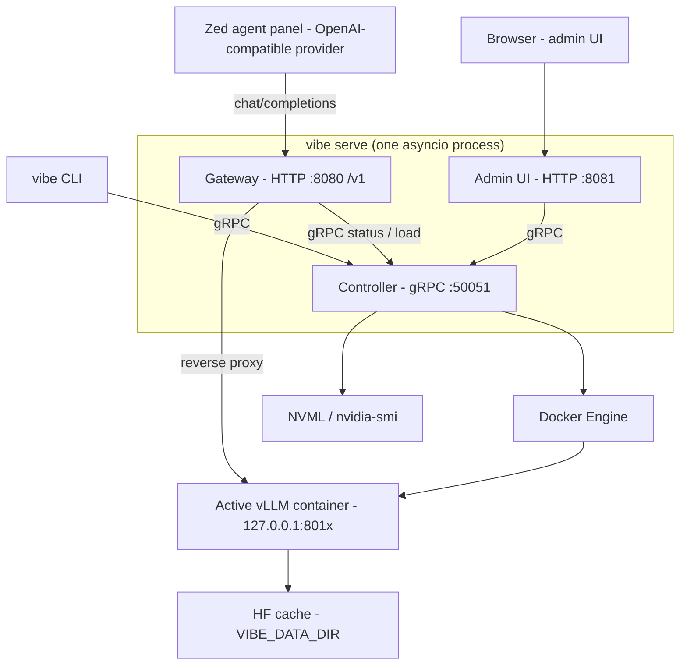

# vibe.code-agent — v1 Feature Plan

Planning index for upgrading the v0 vLLM sandbox into a full local LLM dev environment:
a gRPC model controller, an OpenAI-compatible gateway usable from Zed, a zero-JS admin UI,
model download tooling, and a `laboratory/` for fine-tuning and distillation experiments.

These documents are **plans only**. No code in this directory; implementation lands in the repo
root per the layout below.

## v0 baseline (what exists today)

- One `vllm/vllm-openai:latest` container per model, `--gpus all --ipc=host`, `~/.cache/huggingface` mounted, `HF_TOKEN` from `.env`.
- Bash scripts in `scripts/` run containers in the **foreground**; Makefile `clean-vram` does `docker rm -f` on the three known names first.
- Ports (per scripts — the repo `README.md` table is stale):

  | Container | Host port | Model | `max_model_len` | `gpu_mem_util` |
  | --- | --- | --- | --- | --- |
  | `vllm-deepseek` | 8010 | `casperhansen/DeepSeek-R1-Distill-Qwen-14B-AWQ` | 7984 | 0.85 |
  | `vllm-llama` | 8020 | `hugging-quants/Meta-Llama-3.1-8B-Instruct-AWQ-INT4` | 16384 | 0.75 |
  | `vllm-qwen` | 8030 | `Qwen/Qwen2.5-Coder-7B-Instruct-AWQ` | 32768 | 0.7 |

- `scripts/test_chat.py` port-scans 8010/8020/8030, reads `/v1/models`, streams a chat completion.
- Hardware: CachyOS (Arch rolling), RTX 4070 Ti SUPER 16 GB, Ryzen 7800X3D, 32 GB RAM, 4 TB NVMe, driver 610.43.02 / CUDA 13.3, nvidia-ctk 1.19.1. Wayland desktop holds ~830 MiB VRAM.
- **Invariant:** one model resident in VRAM at a time. A swap = teardown + cold start (30–120 s).

## Target architecture



### Ports (all bound to `127.0.0.1`; `VIBE_BIND` overrides)

| Service | Port | Notes |
| --- | --- | --- |
| vLLM containers | 8010 / 8020 / 8030 | one active at a time; bound `127.0.0.1:<port>:8000` |
| Controller (gRPC) | 50051 | only process that touches Docker/NVML |
| Gateway (HTTP) | 8080 | `http://localhost:8080/v1` — what Zed points at |
| Admin UI (HTTP) | 8081 | zero-JS FastAPI + Jinja2 |
| Caddy (optional) | 8443 → 8080, 8444 → 8081 | `tls internal`, off by default |

### Process model

`vibe serve` starts controller, gateway, and admin in one asyncio event loop. `--only controller|gateway|admin`
runs a single component (for debugging or systemd splitting). Gateway and admin never call Docker directly —
all control goes through gRPC, so the components can be split across processes later without redesign.

## Architecture decisions (condensed)

| ADR | Decision |
| --- | --- |
| 1 | Python 3.12 + `uv`; package `vibe` in `src/vibe/`. Control plane has **no torch dependency**. |
| 2 | `models.yaml` registry replaces bash scripts. `alias` = `--served-model-name` = the `model` string clients send. Aliases `deepseek-r1-14b`, `llama-3.1-8b`, `qwen2.5-coder-7b`; containers `vibe-<alias>`. `make qwen` → `uv run vibe load qwen2.5-coder-7b`. |
| 3 | Pin `VLLM_IMAGE_TAG` (never `latest`). Detached containers, `127.0.0.1:<port>:8000`, labels `vibe.managed=true`, `vibe.alias=<alias>`. Readiness = `/health` 200 then alias listed in `/v1/models`. Single-model invariant; purge legacy `vllm-*`. |
| 4 | Ports as above. `vibe serve` runs all three components; `--only` to isolate. Only controller touches Docker/NVML. |
| 5 | `proto/vibe/v1/control.proto`, package `vibe.v1`, service `ModelController`; codegen with `grpcio-tools` into `src/vibe/gen/` (committed). Streaming RPCs for jobs/logs/chat/downloads. States `AVAILABLE, LOADING, READY, UNLOADING, ERROR`. No auth in v1; additive-only proto. |
| 6 | Gateway is a byte-for-byte HTTP reverse proxy to the active vLLM (SSE passthrough) on fixed 8080. `/v1/models` lists **all** aliases, marks active. Swap-on-request opt-in (`VIBE_SWAP_ON_REQUEST`), else `503` + `Retry-After`. HTTP→gRPC transcoding rejected. Tool calling via per-model `extra_args`. |
| 7 | Admin UI: FastAPI + Jinja2, **zero JavaScript**, vendored classless CSS. Meta-refresh for live views, POST-redirect-GET, chunked-HTML chat streaming, cookie-keyed server-side chat sessions. |
| 8 | `HF_HOME=${VIBE_DATA_DIR:-~/.cache/huggingface}` shared by containers and lab. `laboratory/models/` (gitignored, dockerignored) for GGUF, LoRA checkpoints, distilled outputs, exported safetensors. |
| 9 | `laboratory/` is a uv workspace member. Runtime: `pytorch/pytorch:<ver>-cuda12.x-cudnn-devel` container (CUDA 12.x userland on the 13.3 driver) or a uv venv with cu12x wheels. Scripts: download, HF inference, GGUF inference, LoRA fine-tune, distill, export. |
| 10 | `.env` keys: `HF_TOKEN, VIBE_DATA_DIR, VIBE_BIND, VIBE_SWAP_ON_REQUEST, VIBE_SWAP_TIMEOUT (180), VIBE_LOAD_TIMEOUT (600), VLLM_IMAGE_TAG`. Structured logs to stdout; controller ring-buffers the last job's logs. |
| 11 | Phased delivery (below). Each phase leaves the system usable; `make qwen` keeps working throughout. |

## Roadmap

Doc numbering follows the original feature list (1 UI, 2 gRPC, 3 gateway, 4 scripts, 5 lab); **phase order differs**.

| Phase | Doc | Delivers | Depends on |
| --- | --- | --- | --- |
| 0 | [`00-foundation.md`](00-foundation.md) | `models.yaml`, `vibe` CLI, Docker/GPU modules, job runner; scripts retired | — |
| 1 | [`02-grpc-server.md`](02-grpc-server.md) | gRPC `ModelController`, CLI becomes a gRPC client | 0 |
| 2 | [`03-openai-gateway.md`](03-openai-gateway.md) | OpenAI-compatible gateway on 8080, **Zed integration** | 1 |
| 3 | [`01-admin-ui.md`](01-admin-ui.md) | Zero-JS admin UI on 8081: dashboard, load/unload, chat, logs | 1, 2 |
| 4 | [`04-model-scripts.md`](04-model-scripts.md) | Download RPCs, `vibe download`, `/developer` page, register-into-registry flow | 1, 3 |
| 5 | [`05-laboratory-workflow.md`](05-laboratory-workflow.md) | `laboratory/` workspace: HF/GGUF inference, QLoRA, distillation, export round-trip | 0, 2, 4 |

## Target repo layout

```
Makefile
pyproject.toml              # uv workspace root; package "vibe"
models.yaml                 # model registry (ADR-2)
.env / .env.example
proto/vibe/v1/control.proto
src/vibe/
  cli.py  config.py  registry.py  docker_ctl.py  gpu.py  jobs.py
  gen/                      # grpcio-tools output (committed)
  controller/               # gRPC servicer
  gateway/                  # OpenAI-compatible ASGI app
  admin/                    # FastAPI + Jinja2 templates + vendored CSS
deploy/                     # Caddyfile, systemd units
scripts/                    # legacy; removed at end of Phase 0
laboratory/                 # uv workspace member (Phase 5)
.zed/docs/fable-5/features/ # these docs
```

## Cross-cutting requirements

| ID | Requirement |
| --- | --- |
| XR-1 | Everything binds `127.0.0.1` by default. Exposing beyond loopback requires an explicit `VIBE_BIND` change and is documented as unsafe without Caddy TLS. |
| XR-2 | Single-model invariant is enforced in exactly one place (controller). Every load path purges managed and legacy containers first. |
| XR-3 | `models.yaml` is the only source of truth for model parameters; no port/repo/len literals elsewhere. |
| XR-4 | Every long-running operation (load, unload, download) is a **job** that streams progress events and terminates with success or a typed error. |
| XR-5 | No component other than the controller imports `docker` or `pynvml`. |
| XR-6 | Image tags are pinned. `latest` is rejected by config validation. |
| XR-7 | No network dependency at runtime beyond Docker Hub / Hugging Face pulls: CSS vendored, no CDN, no JS. |
| XR-8 | Each phase ships with `uv run pytest` passing and `make qwen` / `make status` / `make stop` working. |

## Follow-ups discovered in v0 (fixed by Phase 0)

- Repo `README.md` port table says 8000/8001/8002; scripts use 8010/8020/8030.
- `vllm/vllm-openai:latest` is unpinned — a rolling image on a rolling OS.
- `scripts/start_*.sh` run in the foreground (no `-d`), so `make qwen` blocks the terminal.
- `scripts/test_chat.py` port-scans; with the gateway it should target `localhost:8080` and a fixed alias.

## Glossary

- **alias** — short registry key, also the `--served-model-name` and the OpenAI `model` field.
- **active model** — the single vLLM container currently in `READY` (or transitioning) state.
- **job** — a streamed, cancellable long-running operation (load/unload/download).
- **control plane** — gRPC controller + its clients (CLI, gateway, admin).
- **data plane** — HTTP traffic from clients through the gateway to vLLM.
- **lab** — the `laboratory/` workspace for training/distillation with torch, separate from the control plane.
