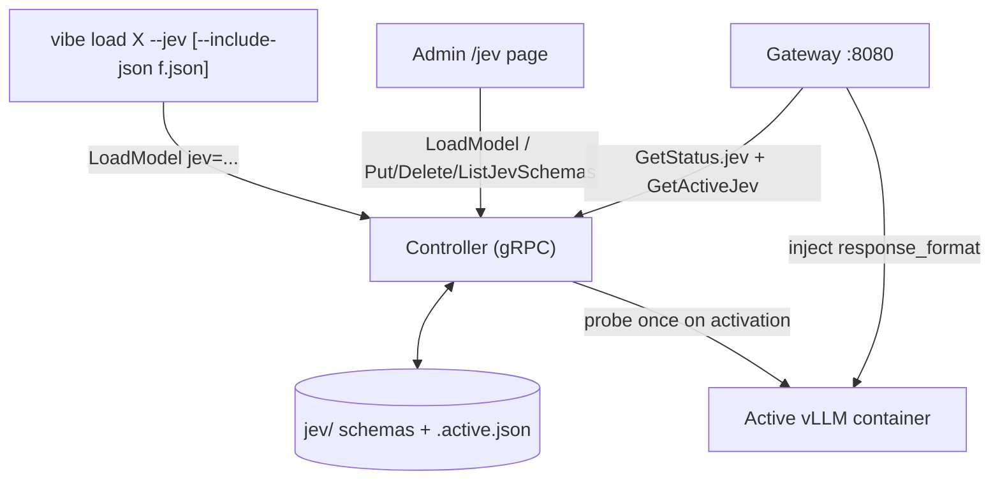
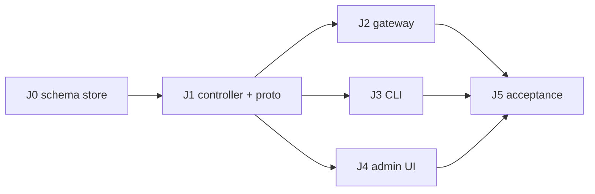

# vibe.code-agent — Jev (schema-constrained decisions) Plan

Planning index for **Jev**: serving a registry model so that every chat completion is forced to emit JSON
conforming to a JSON Schema (decision / judge / classifier output), with a built-in default schema, a
`--include-json` override on the CLI, and an admin page to edit schemas and launch with one.

These documents are **plans only** — no code accompanies them. They follow the conventions of
[`../improvements/`](../improvements/README.md): requirement IDs `JEV-<doc>.<n>`, severity, task checklists.

**Status (2026-10-17):** J0–J5 implemented and accepted — unit suites green (`make check`), and the
Part 2 GPU/Docker runbook in [`06-testing-and-acceptance.md`](06-testing-and-acceptance.md) passed
A1–A9, B1–B10, C1–C10. The runbook fixed three defects (F1 fast-path detach, F2 deepseek dtype,
F3 admin name gate); details are recorded in doc 06. J6 (the Jev chat panel, doc 07) is implemented
and tested — see [`07-jev-chat-panel.md`](07-jev-chat-panel.md).

## Assumptions to confirm (read first)

The request did not define "Jev" precisely. This plan assumes:

1. **Jev = a *mode* of the currently loaded model**, not a new model. The same vLLM container serves it; output is
   constrained to a JSON Schema via vLLM structured outputs (`response_format: json_schema`). The OpenAI `model`
   string clients send stays the registry alias (ADR-2 / XR-3 untouched).
2. **Enforcement is per-request, injected by the gateway** (ADR-J2), so switching schema or toggling Jev on an
   already-loaded model needs **no vLLM restart**.
3. **The user's example schema is the shape to support**, with the fixes in
   [`01-jev-schema-store.md`](01-jev-schema-store.md#the-example-schema-as-given--what-to-fix) (valid `$schema`
   URI, discriminated `oneOf` so `decision_type` and `result` can't disagree, real `YES`/`NO` enums in place of
   `option_a/b/c`).
4. `--include-json` takes a **schema file path** (or `-` for stdin). The `-json` suffix keeps it distinct from
   `vibe download --include` (a glob).

If any of these is wrong, only docs 02–03 (state + enforcement location) change materially; docs 01, 04, 05 are
robust to it.

## v1 baseline relevant to Jev

- `docker_ctl._build_cmd` builds vLLM args from `ModelSpec` only; `--served-model-name <alias>`.
- `JobRunner.load` is the **only** place the single-model invariant is enforced (XR-2). A fast path for "same alias
  already READY" exists but just says "use --force".
- Gateway (`gateway/app.py`) is a byte-for-byte proxy (ADR-6): it already parses the JSON body to read `model`, then
  forwards the **original bytes**. `Status` snapshot (TTL 5 s) is cached in `_SnapshotCache`.
- Admin is zero-JS FastAPI + Jinja2; forms are urlencoded, parsed by `parse_form` (no `python-multipart`);
  `SecurityMiddleware` does Host + Origin checks; every POST 303-redirects.
- `jsonschema` is **not** in `uv.lock` today (needs a lock update with network, see doc 01).
- Proto is additive-only; `LoadModelRequest` currently has fields 1–4; `Status` 1–7; `JobEvent` 1–9.

## Target architecture

## Architecture decisions

| ADR | Decision |
| --- | --- |
| J1 | Jev is an overlay on the active model: state `{alias, schema name, sha256, schema}` held by the controller, cleared whenever the container is purged/unloaded or the alias changes. |
| J2 | Enforcement = gateway injects `response_format: {type: json_schema, json_schema: {name, schema, strict: true}}` into `POST /v1/chat/completions` for the active alias. Rejected: server-level default (vLLM has no per-server schema), `<alias>-jev` second alias (breaks XR-3, doubles `/v1/models`, needs a second container or a rewrite layer anyway). |
| J3 | Schemas are controller-owned (XR-5 spirit: gateway/admin/CLI never touch the store). Built-ins ship in package data (`src/vibe/jev/builtin/`); user schemas live in `${VIBE_JEV_DIR:-./jev}/<name>.json`; a user file named `default` **shadows** the built-in `default`. |
| J4 | Precedence for choosing the schema at launch: `--include-json FILE` (or inline admin text) > `--schema NAME` > the model's optional `jev_schema` in `models.yaml` > `default` (user override of `default`, else built-in). |
| J5 | Proto stays additive: `LoadModelRequest.jev` + `jev_mode`, `Status.jev`, `JobEvent.error_code`, new schema CRUD/validate RPCs, `GetActiveJev`. Load/attach/detach is **one job type** (XR-4 holds; no unary "long" op). |
| J6 | Activation runs a one-shot **probe** (a tiny chat completion with the schema, response validated with `jsonschema`) so backend-unsupported schemas fail at launch, not on the first real request. |
| J7 | Validation is centralised in `vibe/jev/schema.py` (pure Python, unit-testable): draft check, size/depth caps, remote `$ref` ban, xgrammar-hostile keyword warnings. Used by CLI (offline `validate`), controller (authoritative), admin (live errors). |
| J8 | New dependency `jsonschema>=4.23` (pure-Python + `referencing`/`rpds-py` wheels; torch-free, NFR-05.1 preserved). |
| J9 | Jev v1 supports **chat completions only**. `/v1/completions` in Jev mode → 400; embeddings pass through. |

## Roadmap

| Phase | Doc | Delivers | Depends on |
| --- | --- | --- | --- |
| J0 | [`01-jev-schema-store.md`](01-jev-schema-store.md) | `vibe.jev` package: built-in `default`, validator, store, `jsonschema` dep | — |
| J1 | [`02-controller-proto-jobs.md`](02-controller-proto-jobs.md) | Proto additions, `JevState`, `JobRunner` attach/detach/probe, servicer RPCs, `ModelSpec.jev_schema` | J0 |
| J2 | [`03-gateway-enforcement.md`](03-gateway-enforcement.md) | Request injection, incompatible-request rejection, `/v1/models` + `/health` markers | J1 |
| J3 | [`04-cli.md`](04-cli.md) | `vibe load --jev/--include-json/--schema`, `vibe jev …` group, exit codes | J1 (J0 for offline `validate`) |
| J4 | [`05-admin-ui-schema-page.md`](05-admin-ui-schema-page.md) | `/jev` list/edit/validate/delete/launch pages, quick builder, dashboard badge | J1 (J2 to see effect) |
| J5 | [`06-testing-and-acceptance.md`](06-testing-and-acceptance.md) | Unit-test plan + GPU runbook (real vLLM returns schema-valid JSON) | all |
| J6 | [`07-jev-chat-panel.md`](07-jev-chat-panel.md) | `/jev/chat` zero-JS panel: prompt the active model through the gateway, stream the JSON, inspect validity/truncation | J2, J4 |

J2, J3, J4 touch disjoint files and can proceed **in parallel** once J1's proto lands.

## Cross-cutting requirements

| ID | Requirement |
| --- | --- |
| JEV-X.1 | Loopback only (XR-1). No new listeners. |
| JEV-X.2 | Single-model invariant stays in `JobRunner` (XR-2). Jev attach/detach never starts or stops a container. |
| JEV-X.3 | No schema, port, or model literal outside `models.yaml` / the schema store (XR-3). Built-in default is a JSON file, not a Python dict. |
| JEV-X.4 | Only the controller reads/writes the schema store; gateway/admin/CLI go through gRPC. The CLI may read an `--include-json` file **client-side** (it's the caller's file) and ship the text. |
| JEV-X.5 | Zero JS, no CDN (XR-7). Schema editor is a `<textarea>` + server-side validation + POST-redirect-GET. |
| JEV-X.6 | Proto additive-only; regenerate with `make proto`; never hand-edit `src/vibe/gen/**`. |
| JEV-X.7 | Each phase ships with `uv run --offline pytest -q` and `uv run pyright` green; `make qwen/status/stop` unchanged for non-Jev use (XR-8). |
| JEV-X.8 | Plain (non-Jev) behaviour is bit-for-bit unchanged: no body re-serialisation, no extra headers, when Jev is inactive. |

## Error taxonomy (shared by all docs)

| `error_code` (JobEvent / HTTP `error.code`) | Meaning | CLI exit | HTTP |
| --- | --- | --- | --- |
| `jev_schema_not_found` | `--schema NAME` / admin selection doesn't exist | 3 | 404 (admin) |
| `jev_schema_invalid` | not JSON, not an object, bad draft, too large/deep, remote `$ref` | 2 | 400/200+banner |
| `jev_probe_failed` | backend rejected the schema (400) or probe output didn't validate | 1 | — |
| `jev_unsupported_model` | (optional, doc 02) model opted out / reasoning model w/o parser | 1 | — |
| `jev_incompatible_request` | gateway: `tools`/`tool_choice` ≠ none, or `/v1/completions` in Jev mode | — | 400 |
| `jev_not_active` | detach requested with nothing attached (idempotent: info event, not error) | 0 | — |

## Open questions (do not block J0/J1)

- Should `jev/` be committed (shared schemas) or gitignored (local)? Plan default: **gitignored** except `.gitkeep`;
  `make jev-export`-style sharing deferred.
- Should Jev prepend an instruction message (e.g. "Answer only with JSON matching the schema")? Plan: **no** in v1
  (gateway never edits `messages`); listed as follow-up `JEV-FU.1` after the runbook shows real quality.
- Reasoning model (`deepseek-r1-14b`, no `--reasoning-parser`): grammar applies from the first token, so `<think>`
  is suppressed. Works, lower quality. Plan warns (doc 02) rather than blocks.
- Non-streaming response validation in the gateway (`X-Vibe-Jev-Valid`)? Deferred.

## Reminders carried over

- Rotate the `HF_TOKEN` that was printed earlier in the session; never `cat .env`.
- The `[DEBUG] waiting for the job to make progress` heartbeat during `vibe load` is normal; the silent image-pull
  gap is tracked separately (improvements plan 08).
