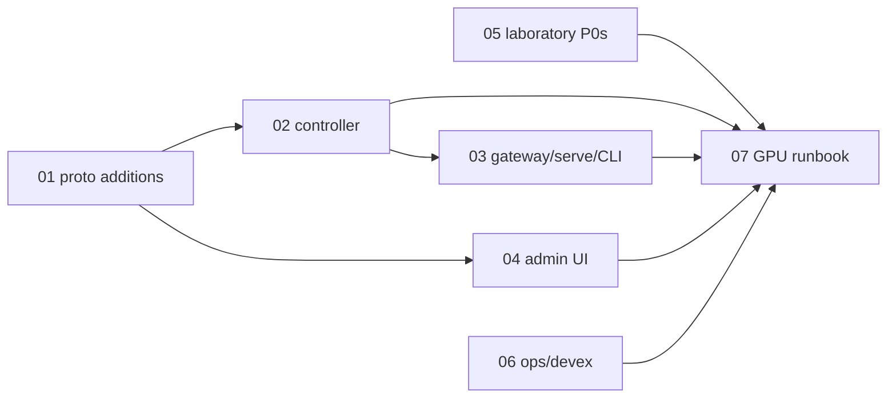

# vibe.code-agent — Post-implementation Improvement Plans

> **Implementation status** (updated as fixes land):
> - ✅ `01-proto-additions` — Implemented (`bda05ce`)
> - ✅ `02-controller-hardening` — Implemented (`bda05ce`)
> - ✅ `03-gateway-serve-cli` — Implemented (`6fe271f`)
> - ✅ `04-admin-ui-fixes` — Implemented (`8baff1f`)
> - ✅ `05-laboratory-fixes` — Implemented except IMP-05.3 (GPU-gated AWQ check; runbook D5)
> - ✅ `06-ops-devex` — Implemented (`a4b3630` + follow-ups)
> - ◐ `07-testing-and-acceptance` — Part 1 (tests) implemented; Part 2 (GPU/Docker acceptance runbook) pending execution on the target machine.

Planning index for fixes and improvements identified by reviewing the Phase 0–5 implementation
(commits `a6561a6` → `b101d0c`). The feature docs in [`../features/`](../features/README.md) remain the
specification; these documents describe **deviations, defects, and hardening work** discovered after the
fact. They are **plans only** — no code changes accompany them.

## How the review was done

Four read-only reviewers with disjoint scopes (controller/jobs/registry, gateway/serve/CLI, admin UI,
laboratory) audited the code against the FR/NFR tables of each feature doc and the cross-cutting
requirements XR-1..XR-8. Findings were then spot-checked by hand. Nothing in this repository has been run
against a real GPU or Docker daemon yet; items that could only be verified on the target machine are collected
in a runbook ([`07-testing-and-acceptance.md`](07-testing-and-acceptance.md)).

## Severity scale

| Level | Meaning |
| --- | --- |
| **P0** | Blocks the documented happy path on the target machine (would fail on first real run). |
| **P1** | Spec requirement not met, data-integrity risk, or a bug users will hit in normal use. |
| **P2** | Hardening, consistency, DX, or accessibility; safe to defer. |

## P0 summary (fix before the first GPU session)

| # | Where | Problem | Doc |
| --- | --- | --- | --- |
| 1 | `laboratory/finetune_lora.py:198-205` | `SFTTrainer(tokenizer=…, max_seq_length=…, args=TrainingArguments)` is the TRL ≤0.11 API; the lock has **trl 1.13** / **transformers 5.17** → `TypeError` on first run. `train_dataset` is a `list`, not a `datasets.Dataset`. | [05](05-laboratory-fixes.md) |
| 2 | `Makefile:70-71` | Lab containers run without `--network host` and without the `vibe` package → `serving_guard` silently skipped (NFR-05.4), `distill.py`/`export.py` `_run_cli` crash, gateway `localhost:8080` unreachable. | [05](05-laboratory-fixes.md) |
| 3 | `laboratory/pyproject.toml`, `uv.lock` | `autoawq-kernels 0.0.9` (built Nov 2024) against torch 2.6.0 (Jan 2025) — probable C++ ABI `ImportError`. Must be verified on GPU; have a fallback (`llmcompressor`) ready. | [05](05-laboratory-fixes.md) |

## Documents

| Doc | Scope | P0 | P1 | P2 |
| --- | --- | --- | --- | --- |
| [`01-proto-additions.md`](01-proto-additions.md) | Additive `control.proto` changes that unblock several UI/CLI fixes (job metadata, download timestamps, `RegistrationSpec` completeness, `GetStatus` transitional states) | 0 | 3 | 4 |
| [`02-controller-hardening.md`](02-controller-hardening.md) | `servicer.py`, `jobs.py`, `docker_ctl.py`, `downloads.py`, `cache.py`, `registry.py`, `client.py` | 0 | 10 | 18 |
| [`03-gateway-serve-cli.md`](03-gateway-serve-cli.md) | `serve.py` lifecycle, swap coordinator, proxy error handling, structured logging, CLI `--json`, Zed settings drift | 0 | 7 | 14 |
| [`04-admin-ui-fixes.md`](04-admin-ui-fixes.md) | CSRF/Origin defence, chat streaming deadlines + truncation, `/logs/stream`, absolute `url_for`, reload-registry button, a11y | 0 | 7 | 23 |
| [`05-laboratory-fixes.md`](05-laboratory-fixes.md) | TRL/transformers API alignment, container networking, torch duplication, `HF_HOME` layout, guard key mismatch, seed, distill/export correctness | 3 | 17 | 9 |
| [`06-ops-devex.md`](06-ops-devex.md) | `pyright` + `protobuf` in `pyproject`, README/Makefile drift, systemd/Caddy, `HEAD` support, `_load_config` dedupe | 0 | 1 | 10 |
| [`07-testing-and-acceptance.md`](07-testing-and-acceptance.md) | Unit-test gaps per area + the manual GPU/Docker acceptance runbook | — | — | — |

## Suggested order

1. **05 P0s first** — they are small (API rename, two Makefile flags, one import smoke) and gate the entire lab.
2. **01 → 02 → 04** — proto additions are prerequisites for the admin `known_jobs`/download side-channel removal.
3. **03** in parallel with 04 (disjoint files).
4. **06** anytime.
5. **07** on the target machine once 05 P0s land; record results back into the feature docs' "Status" lines.

## Invariants re-confirmed by the review

- **XR-2** single-model purge only in the controller-owned `JobRunner` (`jobs.py:163, 229`).
- **XR-5** `import docker` only in `docker_ctl.py`; `pynvml` only in `gpu.py`; admin/gateway/lab import neither.
- **XR-6** `latest` and empty tags rejected in `config.py:39-48`.
- **XR-7** zero JS, exact CSP, vendored 96-line CSS, no `@import`/`url()`.
- **NFR-05.1** root `uv sync` is torch-free (workspace member not installed by default).

## Conventions for these docs

Each plan uses the same skeleton as the feature docs: header (Priority · Depends · Status), Summary,
Goals/Non-goals, Requirements table (`IMP-<doc>.<n>`), Design notes, Task breakdown (checkboxes),
Acceptance criteria, Risks. File:line references point at commit `b101d0c` and will drift as fixes land.
